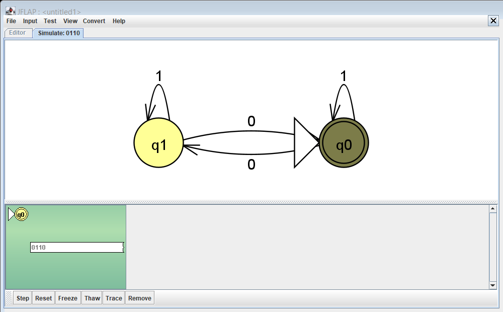
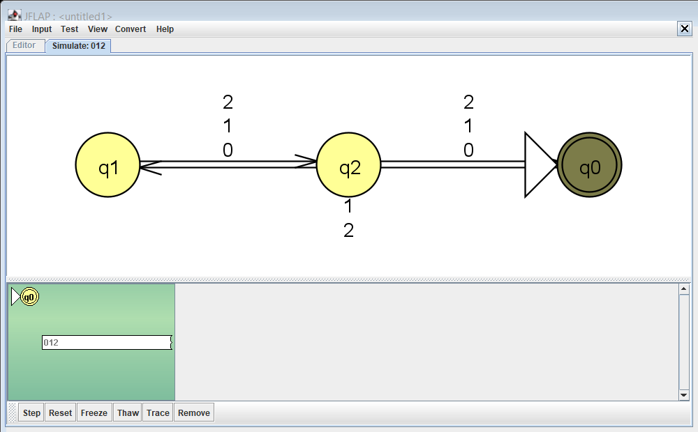
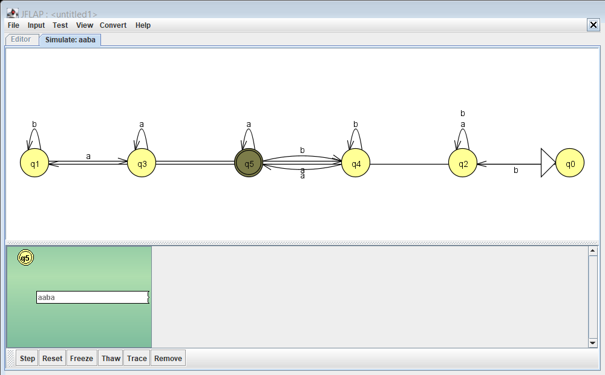
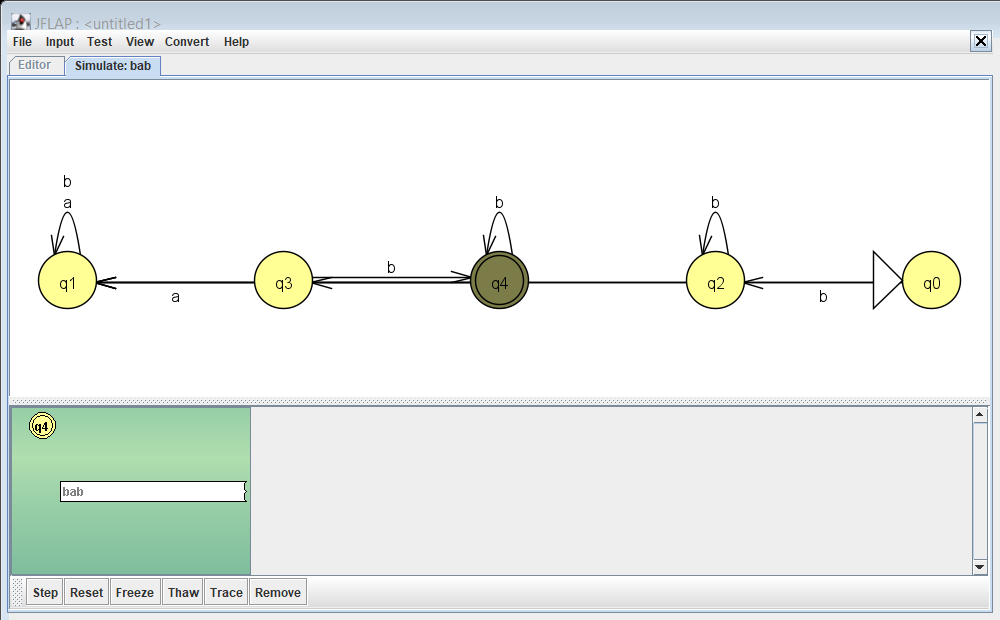
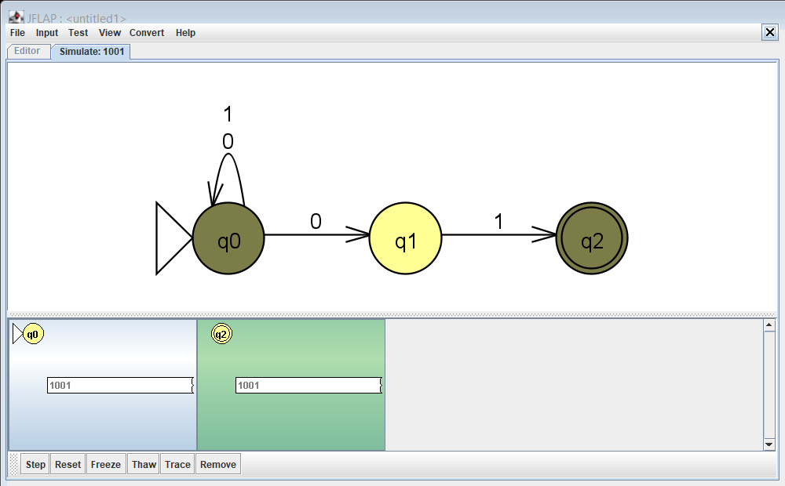
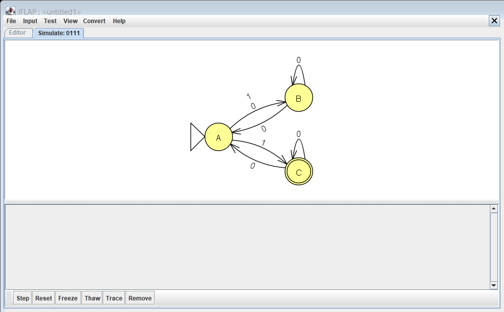
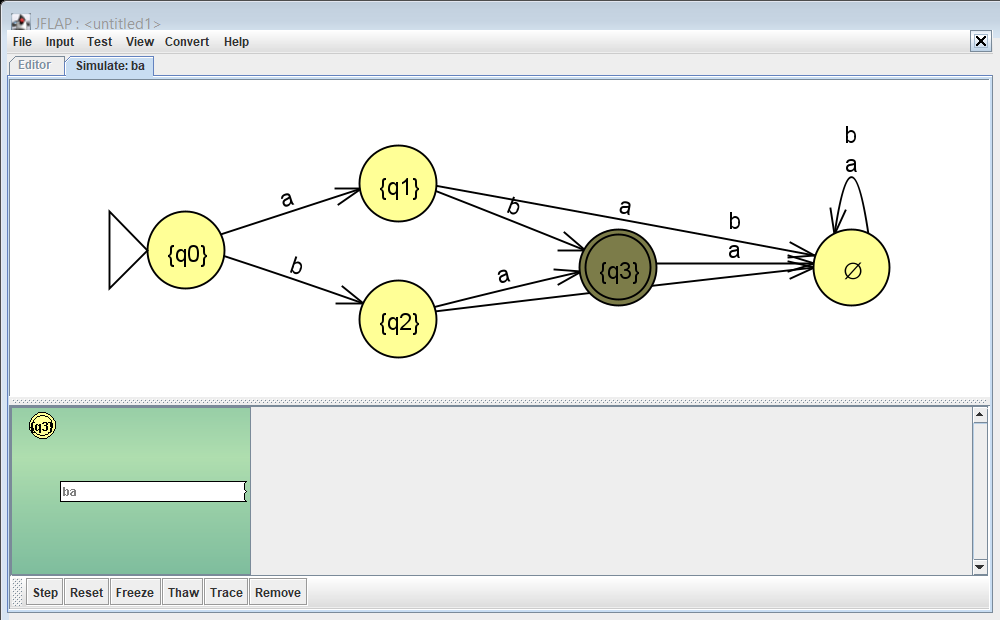

# Ejercicio 4. Autómatas finitos en JFLAP

Este documento resuelve los problemas con asterisco de la Lista 2 y de la Lista 3. Hay 101 archivos `.jff` en `automatas/`. Las tablas y los resultados se generan con `herramientas/generar_reporte.py` a partir de esos archivos, de modo que no pueden diferir de ellos.

## Cómo se validó

1. **Contra el enunciado.** `herramientas/catalogo.py` define cada lenguaje a partir de su enunciado, sin usar el autómata. `tests/test_automatas.py` compara ambos con 525 293 cadenas, entre ellas todas las cortas sobre cada alfabeto y otras largas al azar. No hubo discrepancias.
2. **En JFLAP.** `herramientas/JflapLote.java` ejecuta 540 casos en el motor de JFLAP 7.1. Los resultados están en `evidencias/jflap/resultados-jflap.tsv`. Cada autómata tiene al menos tres cadenas válidas, tres inválidas y un caso frontera, salvo los lenguajes finitos, donde se indica.
3. **Paso a paso.** Se simularon siete autómatas en la ventana de JFLAP. `herramientas/JflapPasos.java` conduce la ventana y guarda la imagen de cada paso.

Los problemas 128, 143, 156 a 161, 261 y 263 se dan por figura, y sus archivos se cotejaron con la figura a alta resolución. En 156 y 157, la definición de referencia es esa misma transcripción.

**Cómo leer las tablas.** → marca el estado inicial y ∗ los de aceptación. La última columna da la cadena más corta que alcanza cada estado, como ejemplo de la información del prefijo que el estado resume.

## Correcciones respecto a la Tarea 2

Al cotejar las figuras se hallaron dos errores en lo entregado en la Tarea 2. Aquí ya están corregidos:

| Problema | En la Tarea 2 | Correcto según la figura |
|---|---|---|
| 128 | F era absorbente y F' = {D, E, F} | F regresa a D con 0 y con 1, por lo que F' = {D, E} |
| 143(b) | q0 pasaba a q1 con a y con b; L = Σ⁺ | q0 solo sale con a y q1 regresa a q0 con b; L = a(a+b)* |

Ejemplo del 128: `0010011` termina en D y no pertenece a L; con la tabla de la Tarea 2 sí pertenecía, porque F no se abandonaba.

## Simulación paso a paso en JFLAP

Cada figura es la ventana real de JFLAP, en la vista *Input → Step with Closure*, tras leer toda la cadena. El estado sombreado es la configuración actual; el fondo verde indica aceptación. Los pasos intermedios se guardan junto a cada figura en `evidencias/jflap/`.

**`ejercicio_139.jff` con `0110`** (Par de ceros)

**`ejercicio_097.jff` con `012`** (Longitud múltiplo de 3)

**`ejercicio_118.jff` con `aaba`** (a x ab y a, palabra más corta)

**`ejercicio_135.jff` con `bab`** (bᵐ a bⁿ, palabra más corta)

**`ej263_AFN.jff` con `1001`** (AFN: varias configuraciones simultáneas)

**`ej192_AFN.jff` con `0111`** (AFN del problema 192 a))

**`ej262_AFD.jff` con `ba`** (AFD para {ab, ba})

## Lista 2: autómatas finitos (94 a 150)

Los problemas con asterisco sin autómata propio se resuelven al final de esta lista.

### Problema 97 — `ejercicio_097.jff`

**Enunciado.** Palabras de Σ₁ = {0,1,2} cuya longitud es múltiplo de 3.

**Diseño.** Solo importa la longitud: el estado guarda el residuo |prefijo| mod 3. q0 es inicial y de aceptación porque |λ| = 0.

| Estado | 0 | 1 | 2 | Prefijo más corto que llega |
|---|---|---|---|---|
| q1 | q2 | q2 | q2 | `0` |
| q2 | q0 | q0 | q0 | `00` |
| →∗q0 | q1 | q1 | q1 | λ |

| Cadena | Se espera | JFLAP | Caso |
|---|---|---|---|
| λ | Acepta | Acepta | frontera: vacía |
| `222001` | Acepta | Acepta |  |
| `010122` | Acepta | Acepta |  |
| `0111121` | Rechaza | Rechaza |  |
| `2` | Rechaza | Rechaza |  |
| `2022010` | Rechaza | Rechaza |  |

### Problema 99 — `ejercicio_099.jff`

**Enunciado.** Palabras de Σ₁ que terminan con 001001.

**Diseño.** Autómata de búsqueda de sufijo (función de fallo tipo KMP): el estado qj indica que los últimos j símbolos leídos son el prefijo más largo de 001001 que es sufijo del prefijo leído. Un 2 regresa siempre a q0. Solo q6 acepta y puede abandonarse si llegan más símbolos.

| Estado | 0 | 1 | 2 | Prefijo más corto que llega |
|---|---|---|---|---|
| q1 | q2 | q0 | q0 | `0` |
| q3 | q4 | q0 | q0 | `001` |
| ∗q6 | q4 | q0 | q0 | `001001` |
| q5 | q2 | q6 | q0 | `00100` |
| q4 | q5 | q0 | q0 | `0010` |
| q2 | q2 | q3 | q0 | `00` |
| →q0 | q1 | q0 | q0 | λ |

| Cadena | Se espera | JFLAP | Caso |
|---|---|---|---|
| `001001` | Acepta | Acepta | frontera: aceptada más corta |
| `11001001` | Acepta | Acepta |  |
| `0001001` | Acepta | Acepta |  |
| λ | Rechaza | Rechaza | frontera: vacía |
| `01001` | Rechaza | Rechaza | frontera: un símbolo menos |
| `111001001122` | Rechaza | Rechaza |  |

### Problema 102 — `ejercicio_102.jff`

**Enunciado.** Palabras de Σ₃ = {a,b} que contienen abbbab.

**Diseño.** Mismo principio de búsqueda: qj = j símbolos de abbbab ya coinciden. q6 es de aceptación y absorbente: una vez hallada la subcadena, lo que siga no importa.

| Estado | a | b | Prefijo más corto que llega |
|---|---|---|---|
| q1 | q1 | q2 | `a` |
| q3 | q1 | q4 | `abb` |
| ∗q6 | q6 | q6 | `abbbab` |
| q5 | q1 | q6 | `abbba` |
| q4 | q5 | q0 | `abbb` |
| q2 | q1 | q3 | `ab` |
| →q0 | q1 | q0 | λ |

| Cadena | Se espera | JFLAP | Caso |
|---|---|---|---|
| `abbbab` | Acepta | Acepta | frontera: aceptada más corta |
| `abbbabbbaaa` | Acepta | Acepta |  |
| `babbbabbaa` | Acepta | Acepta |  |
| λ | Rechaza | Rechaza | frontera: vacía |
| `bbbab` | Rechaza | Rechaza | frontera: un símbolo menos |
| `x` | Rechaza | Rechaza | símbolo fuera de Σ |

### Problema 103 — `ejercicio_103.jff`

**Enunciado.** Palabras de Σ₃ que contienen aabbba.

**Diseño.** Búsqueda de aabbba: qj = longitud del mayor prefijo del patrón que es sufijo de lo leído; q6 absorbente de aceptación.

| Estado | a | b | Prefijo más corto que llega |
|---|---|---|---|
| q1 | q2 | q0 | `a` |
| q3 | q1 | q4 | `aab` |
| ∗q6 | q6 | q6 | `aabbba` |
| q5 | q6 | q0 | `aabbb` |
| q4 | q1 | q5 | `aabb` |
| q2 | q2 | q3 | `aa` |
| →q0 | q1 | q0 | λ |

| Cadena | Se espera | JFLAP | Caso |
|---|---|---|---|
| `aabbba` | Acepta | Acepta | frontera: aceptada más corta |
| `aabbbaabab` | Acepta | Acepta |  |
| `bbaabbbababbb` | Acepta | Acepta |  |
| λ | Rechaza | Rechaza | frontera: vacía |
| `abbba` | Rechaza | Rechaza | frontera: un símbolo menos |
| `x` | Rechaza | Rechaza | símbolo fuera de Σ |

### Problema 106 — `ejercicio_106.jff`

**Enunciado.** Palabras de Σ₁ que incluyen la subcadena 1101001.

**Diseño.** Búsqueda de 1101001: qj = j símbolos del patrón coinciden; el 2 no aparece en el patrón y reinicia la búsqueda; q7 absorbente de aceptación.

| Estado | 0 | 1 | 2 | Prefijo más corto que llega |
|---|---|---|---|---|
| q1 | q0 | q2 | q0 | `1` |
| q3 | q0 | q4 | q0 | `110` |
| q6 | q0 | q7 | q0 | `110100` |
| ∗q7 | q7 | q7 | q7 | `1101001` |
| q5 | q6 | q1 | q0 | `11010` |
| q4 | q5 | q2 | q0 | `1101` |
| q2 | q3 | q2 | q0 | `11` |
| →q0 | q0 | q1 | q0 | λ |

| Cadena | Se espera | JFLAP | Caso |
|---|---|---|---|
| `1101001` | Acepta | Acepta | frontera: aceptada más corta |
| `0110100102020` | Acepta | Acepta |  |
| `1101001001202` | Acepta | Acepta |  |
| λ | Rechaza | Rechaza | frontera: vacía |
| `101001` | Rechaza | Rechaza | frontera: un símbolo menos |
| `x` | Rechaza | Rechaza | símbolo fuera de Σ |

### Problema 107 — `ejercicio_107.jff`

**Enunciado.** Palabras de Σ₁ que incluyen al menos una vez 0101 y al menos una vez 021.

**Diseño.** Intersección por autómata producto: cada estado es un par (avance en 0101, avance en 021), y acepta solo cuando ambos patrones ya aparecieron. Se minimizó por particiones a 13 estados.

Tabla de transiciones (13 estados)

| Estado | 0 | 1 | 2 | Prefijo más corto que llega |
|---|---|---|---|---|
| q9 | q11 | q5 | q5 | `02101` |
| q1 | q1 | q2 | q3 | `0` |
| q10 | q8 | q12 | q6 | `010102` |
| q7 | q7 | q9 | q5 | `0210` |
| q3 | q1 | q5 | q0 | `02` |
| q6 | q8 | q6 | q6 | `0101` |
| q11 | q7 | q12 | q5 | `021010` |
| q5 | q7 | q5 | q5 | `021` |
| ∗q12 | q12 | q12 | q12 | `0101021` |
| q4 | q1 | q6 | q3 | `010` |
| q8 | q8 | q6 | q10 | `01010` |
| q2 | q4 | q0 | q0 | `01` |
| →q0 | q1 | q0 | q0 | λ |

| Cadena | Se espera | JFLAP | Caso |
|---|---|---|---|
| `0101021` | Acepta | Acepta | frontera: aceptada más corta |
| `0101010211` | Acepta | Acepta |  |
| `10010102120121` | Acepta | Acepta |  |
| λ | Rechaza | Rechaza | frontera: vacía |
| `101021` | Rechaza | Rechaza | frontera: un símbolo menos |
| `x` | Rechaza | Rechaza | símbolo fuera de Σ |

### Problema 109 — `ejercicio_109.jff`

**Enunciado.** Palabras de Σ₂ = {a,b,c,0,1} que incluyen abbcb y cbaabb, pudiendo traslaparse.

**Diseño.** Producto de dos búsquedas con función de fallo; esta detecta de forma natural los traslapes (abbcbaabb cuenta). Cada estado guarda el avance en cada patrón. Minimizado de 56 a 22 estados.

Tabla de transiciones (22 estados)

| Estado | 0 | 1 | a | b | c | Prefijo más corto que llega |
|---|---|---|---|---|---|---|
| q9 | q12 | q12 | q11 | q12 | q13 | `abbcb` |
| q3 | q0 | q0 | q1 | q5 | q2 | `ab` |
| q7 | q0 | q0 | q1 | q9 | q2 | `abbc` |
| q13 | q12 | q12 | q12 | q9 | q13 | `abbcbc` |
| q19 | q12 | q12 | q12 | q21 | q13 | `abbcbaab` |
| q11 | q12 | q12 | q15 | q12 | q13 | `abbcba` |
| q14 | q17 | q17 | q16 | q17 | q18 | `cbaabb` |
| q6 | q0 | q0 | q8 | q3 | q2 | `cba` |
| →q0 | q0 | q0 | q1 | q0 | q2 | λ |
| q18 | q17 | q17 | q16 | q21 | q17 | `cbaabbc` |
| q10 | q0 | q0 | q1 | q14 | q2 | `cbaab` |
| q5 | q0 | q0 | q1 | q0 | q7 | `abb` |
| q8 | q0 | q0 | q1 | q10 | q2 | `cbaa` |
| q2 | q0 | q0 | q1 | q4 | q2 | `c` |
| q15 | q12 | q12 | q12 | q19 | q13 | `abbcbaa` |
| q20 | q17 | q17 | q16 | q14 | q17 | `cbaabbab` |
| q1 | q0 | q0 | q1 | q3 | q2 | `a` |
| ∗q21 | q21 | q21 | q21 | q21 | q21 | `cbaabbcb` |
| q17 | q17 | q17 | q16 | q17 | q17 | `cbaabb0` |
| q16 | q17 | q17 | q16 | q20 | q17 | `cbaabba` |
| q12 | q12 | q12 | q12 | q12 | q13 | `abbcb0` |
| q4 | q0 | q0 | q6 | q0 | q2 | `cb` |

| Cadena | Se espera | JFLAP | Caso |
|---|---|---|---|
| `cbaabbcb` | Acepta | Acepta | frontera: aceptada más corta |
| `0aaccbaabbcbb0cb00` | Acepta | Acepta |  |
| `bbcbaabbcba` | Acepta | Acepta |  |
| λ | Rechaza | Rechaza | frontera: vacía |
| `baabbcb` | Rechaza | Rechaza | frontera: un símbolo menos |
| `x` | Rechaza | Rechaza | símbolo fuera de Σ |

### Problema 111 — `ejercicio_111.jff`

**Enunciado.** Palabras de Σ₁ que contienen exactamente tres veces 01002.

**Diseño.** El estado es el par (avance en la búsqueda de 01002, ocurrencias vistas, saturadas en 4). 01002 no se traslapa consigo mismo. Acepta si el contador vale 3 al terminar.

Tabla de transiciones (21 estados)

| Estado | 0 | 1 | 2 | Prefijo más corto que llega |
|---|---|---|---|---|
| q9 | q6 | q7 | q10 | `010020100` |
| q3 | q4 | q2 | q0 | `010` |
| q7 | q8 | q5 | q5 | `0100201` |
| q13 | q14 | q12 | q10 | `0100201002010` |
| ∗q19 | q16 | q17 | q20 | `0100201002010020100` |
| q11 | q11 | q12 | q10 | `01002010020` |
| q14 | q11 | q12 | q15 | `01002010020100` |
| q6 | q6 | q7 | q5 | `010020` |
| →q0 | q1 | q0 | q0 | λ |
| ∗q18 | q19 | q17 | q15 | `010020100201002010` |
| q10 | q11 | q10 | q10 | `0100201002` |
| q5 | q6 | q5 | q5 | `01002` |
| q8 | q9 | q7 | q5 | `01002010` |
| q2 | q3 | q0 | q0 | `01` |
| ∗q15 | q16 | q15 | q15 | `010020100201002` |
| q20 | q20 | q20 | q20 | `01002010020100201002` |
| q1 | q1 | q2 | q0 | `0` |
| ∗q17 | q18 | q15 | q15 | `01002010020100201` |
| ∗q16 | q16 | q17 | q15 | `0100201002010020` |
| q12 | q13 | q10 | q10 | `010020100201` |
| q4 | q1 | q2 | q5 | `0100` |

| Cadena | Se espera | JFLAP | Caso |
|---|---|---|---|
| `010020100201002` | Acepta | Acepta | frontera: aceptada más corta |
| `01002010020100212110` | Acepta | Acepta |  |
| `2000100201002010020021` | Acepta | Acepta |  |
| λ | Rechaza | Rechaza | frontera: vacía |
| `10020100201002` | Rechaza | Rechaza | frontera: un símbolo menos |
| `01002010020100201002` | Rechaza | Rechaza |  |

### Problema 112 — `ejercicio_112.jff`

**Enunciado.** Palabras de Σ₁ que contienen dos veces 010 sin traslape (01010 no pertenece; 010010 sí).

**Diseño.** El estado es (avance en 010, ocurrencias contadas). Al completar una ocurrencia la búsqueda vuelve a cero, de modo que sus símbolos no se reutilizan. Acepta con contador exactamente 2.

| Estado | 0 | 1 | 2 | Prefijo más corto que llega |
|---|---|---|---|---|
| q9 | q9 | q9 | q9 | `010010010` |
| q1 | q1 | q2 | q0 | `0` |
| q3 | q4 | q3 | q3 | `010` |
| ∗q6 | q7 | q6 | q6 | `010010` |
| ∗q7 | q7 | q8 | q6 | `0100100` |
| q5 | q6 | q3 | q3 | `01001` |
| q4 | q4 | q5 | q3 | `0100` |
| ∗q8 | q9 | q6 | q6 | `01001001` |
| q2 | q3 | q0 | q0 | `01` |
| →q0 | q1 | q0 | q0 | λ |

| Cadena | Se espera | JFLAP | Caso |
|---|---|---|---|
| `010010` | Acepta | Acepta | frontera: aceptada más corta |
| `0001001002112` | Acepta | Acepta |  |
| `220100101210` | Acepta | Acepta |  |
| λ | Rechaza | Rechaza | frontera: vacía |
| `10010` | Rechaza | Rechaza | frontera: un símbolo menos |
| `2010010200100` | Rechaza | Rechaza |  |

### Problema 113 — `ejercicio_113.jff`

**Enunciado.** Palabras de Σ₁ que contienen dos veces 010, pudiendo traslaparse.

**Diseño.** Igual que el 112, pero tras cada ocurrencia se sigue la función de fallo (el último 0 sirve de inicio de la siguiente), por lo que 01010 sí pertenece.

| Estado | 0 | 1 | 2 | Prefijo más corto que llega |
|---|---|---|---|---|
| q9 | q9 | q9 | q9 | `0101010` |
| q1 | q1 | q2 | q0 | `0` |
| q3 | q3 | q4 | q5 | `010` |
| ∗q6 | q6 | q7 | q8 | `01010` |
| ∗q7 | q9 | q8 | q8 | `010101` |
| q5 | q3 | q5 | q5 | `0102` |
| q4 | q6 | q5 | q5 | `0101` |
| ∗q8 | q6 | q8 | q8 | `010102` |
| q2 | q3 | q0 | q0 | `01` |
| →q0 | q1 | q0 | q0 | λ |

| Cadena | Se espera | JFLAP | Caso |
|---|---|---|---|
| `01010` | Acepta | Acepta | frontera: aceptada más corta |
| `2010102122` | Acepta | Acepta |  |
| `1001010` | Acepta | Acepta |  |
| λ | Rechaza | Rechaza | frontera: vacía |
| `1010` | Rechaza | Rechaza | frontera: un símbolo menos |
| `01120101010` | Rechaza | Rechaza |  |

### Problema 118 — `ejercicio_118.jff`

**Enunciado.** L = {w ∈ Σ₃* : w = a x ab y a, con x, y ∈ Σ₃*}.

**Diseño.** Los estados recuerdan: si el primer símbolo fue a; si ya apareció ab después de esa a; y, una vez visto, si el último símbolo fue a. La palabra más corta es aaba.

| Estado | a | b | Prefijo más corto que llega |
|---|---|---|---|
| q1 | q3 | q1 | `a` |
| q3 | q3 | q4 | `aa` |
| ∗q5 | q5 | q4 | `aaba` |
| q4 | q5 | q4 | `aab` |
| q2 | q2 | q2 | `b` |
| →q0 | q1 | q2 | λ |

| Cadena | Se espera | JFLAP | Caso |
|---|---|---|---|
| `aaba` | Acepta | Acepta | frontera: aceptada más corta |
| `aaaabaabaaa` | Acepta | Acepta |  |
| `abbaabaaaaba` | Acepta | Acepta |  |
| λ | Rechaza | Rechaza | frontera: vacía |
| `aba` | Rechaza | Rechaza | frontera: un símbolo menos |
| `aaaaaabab` | Rechaza | Rechaza |  |

### Problema 120 — `ejercicio_120.jff`

**Enunciado.** Palabras de Σ₁ cuyo primer y último carácter son distintos.

**Diseño.** El estado es (primer símbolo, último símbolo). El primero queda fijo y el segundo se actualiza. λ se rechaza porque no tiene esos caracteres. Tras minimizar quedan 7 estados.

| Estado | 0 | 1 | 2 | Prefijo más corto que llega |
|---|---|---|---|---|
| q1 | q1 | q4 | q4 | `0` |
| q3 | q6 | q6 | q3 | `2` |
| ∗q5 | q5 | q2 | q5 | `10` |
| ∗q4 | q1 | q4 | q4 | `01` |
| ∗q6 | q6 | q6 | q3 | `20` |
| q2 | q5 | q2 | q5 | `1` |
| →q0 | q1 | q2 | q3 | λ |

| Cadena | Se espera | JFLAP | Caso |
|---|---|---|---|
| `01` | Acepta | Acepta | frontera: aceptada más corta |
| `020122` | Acepta | Acepta |  |
| `0111` | Acepta | Acepta |  |
| λ | Rechaza | Rechaza | frontera: vacía |
| `1` | Rechaza | Rechaza | frontera: un símbolo menos |
| `1101` | Rechaza | Rechaza |  |

### Problema 121 — `ejercicio_121.jff`

**Enunciado.** Palabras de Σ₁ de longitud 3n, tales que cada bloque de 3 tiene al menos un 0 (se toma n ≥ 1).

**Diseño.** El estado guarda la posición dentro del bloque y si el bloque ya tiene 0; un bloque sin 0 lleva a un estado de rechazo absorbente. Se toma ℕ = {1, 2, …}, como en la Tarea 2, por lo que λ se rechaza.

| Estado | 0 | 1 | 2 | Prefijo más corto que llega |
|---|---|---|---|---|
| q1 | q3 | q3 | q3 | `0` |
| q4 | q5 | q6 | q6 | `11` |
| q3 | q5 | q5 | q5 | `00` |
| q6 | q6 | q6 | q6 | `111` |
| ∗q5 | q1 | q2 | q2 | `000` |
| q2 | q3 | q4 | q4 | `1` |
| →q0 | q1 | q2 | q2 | λ |

| Cadena | Se espera | JFLAP | Caso |
|---|---|---|---|
| `000` | Acepta | Acepta | frontera: aceptada más corta |
| `000000` | Acepta | Acepta |  |
| `010000` | Acepta | Acepta |  |
| λ | Rechaza | Rechaza | frontera: vacía |
| `00` | Rechaza | Rechaza | frontera: un símbolo menos |
| `00020200` | Rechaza | Rechaza |  |

### Problema 122 — `ejercicio_122.jff`

**Enunciado.** Palabras de Σ₁ en las que toda terna de símbolos consecutivos tiene un 0.

**Diseño.** El estado es el tamaño de la racha actual sin ceros (0, 1 o 2). Con racha 3 se pasa al rechazo absorbente.

| Estado | 0 | 1 | 2 | Prefijo más corto que llega |
|---|---|---|---|---|
| ∗q1 | q0 | q2 | q2 | `1` |
| ∗q2 | q0 | q3 | q3 | `11` |
| q3 | q3 | q3 | q3 | `111` |
| →∗q0 | q0 | q1 | q1 | λ |

| Cadena | Se espera | JFLAP | Caso |
|---|---|---|---|
| λ | Acepta | Acepta | frontera: vacía |
| `0000` | Acepta | Acepta |  |
| `01021` | Acepta | Acepta |  |
| `022122` | Rechaza | Rechaza |  |
| `02110` | Rechaza | Rechaza |  |
| `2112200` | Rechaza | Rechaza |  |

### Problema 123 — `ejercicio_123.jff`

**Enunciado.** Palabras de Σ₃ de la forma w x w, con w ∈ Σ₃² y x ∈ Σ₃*.

**Diseño.** El estado memoriza los dos primeros símbolos, los dos últimos y si ya se leyeron al menos 4. Acepta si coinciden y |w x w| ≥ 4.

Tabla de transiciones (15 estados)

| Estado | a | b | Prefijo más corto que llega |
|---|---|---|---|
| ∗q12 | q8 | q4 | `abab` |
| ∗q13 | q5 | q9 | `baba` |
| q1 | q3 | q4 | `a` |
| q4 | q8 | q4 | `ab` |
| q6 | q6 | q10 | `bb` |
| q8 | q8 | q12 | `aba` |
| q5 | q5 | q9 | `ba` |
| q9 | q13 | q9 | `bab` |
| q7 | q11 | q3 | `aaa` |
| ∗q14 | q6 | q14 | `bbbb` |
| →q0 | q1 | q2 | λ |
| q10 | q6 | q14 | `bbb` |
| q2 | q5 | q6 | `b` |
| q3 | q7 | q3 | `aa` |
| ∗q11 | q11 | q3 | `aaaa` |

| Cadena | Se espera | JFLAP | Caso |
|---|---|---|---|
| `aaaa` | Acepta | Acepta | frontera: aceptada más corta |
| `aaabaaaa` | Acepta | Acepta |  |
| `aaaaa` | Acepta | Acepta |  |
| λ | Rechaza | Rechaza | frontera: vacía |
| `aaa` | Rechaza | Rechaza | frontera: un símbolo menos |
| `aaaaaaabbb` | Rechaza | Rechaza |  |

### Problema 124 — `ejercicio_124.jff`

**Enunciado.** Mecanismo de tres palancas: se acepta si la última canica sale por A.

**Diseño.** Las palancas tienen 2³ = 8 configuraciones. El AFD amplía el estado a (configuración, última salida), con 13 estados alcanzables; acepta los de salida A. Se toma la posición inicial con las tres palancas a la izquierda.

Tabla de transiciones (13 estados)

| Estado | 0 | 1 | Prefijo más corto que llega |
|---|---|---|---|
| →q0 | q1 | q2 | λ |
| ∗q1 | q3 | q4 | `0` |
| ∗q2 | q4 | q5 | `1` |
| ∗q3 | q6 | q7 | `00` |
| ∗q4 | q7 | q8 | `01` |
| q5 | q6 | q7 | `11` |
| ∗q6 | q9 | q10 | `000` |
| q7 | q11 | q9 | `001` |
| q8 | q9 | q10 | `011` |
| q9 | q1 | q2 | `0000` |
| q10 | q2 | q12 | `0001` |
| ∗q11 | q2 | q12 | `0010` |
| q12 | q3 | q4 | `00011` |

| Cadena | Se espera | JFLAP | Caso |
|---|---|---|---|
| `0` | Acepta | Acepta | frontera: aceptada más corta |
| `0010` | Acepta | Acepta |  |
| `011001` | Acepta | Acepta |  |
| λ | Rechaza | Rechaza | frontera: vacía |
| `1011011` | Rechaza | Rechaza |  |
| `00000011` | Rechaza | Rechaza |  |

### Problema 128 — `ejercicio_128_M.jff`

**Enunciado.** Autómata M del diagrama del ejercicio 128 (lenguaje L).

**Diseño.** Transcripción del diagrama: cada estado es uno de A a F del enunciado (q0 = A, …, q5 = F); F es de aceptación y regresa a D con 0 y con 1.

| Estado | 0 | 1 | Prefijo más corto que llega |
|---|---|---|---|
| →q0 | q1 | q2 | λ |
| q1 | q2 | q3 | `0` |
| q2 | q3 | q4 | `1` |
| q3 | q5 | q4 | `01` |
| q4 | q4 | q5 | `11` |
| ∗q5 | q3 | q3 | `010` |

| Cadena | Se espera | JFLAP | Caso |
|---|---|---|---|
| `010` | Acepta | Acepta | frontera: aceptada más corta |
| `11010010111` | Acepta | Acepta |  |
| `1110101` | Acepta | Acepta |  |
| λ | Rechaza | Rechaza | frontera: vacía |
| `10` | Rechaza | Rechaza | frontera: un símbolo menos |
| `0100111` | Rechaza | Rechaza |  |

### Problema 128 — `ejercicio_128_L2.jff`

**Enunciado.** L₂: palabras de L a las que se les quita el último símbolo.

**Diseño.** u ∈ L₂ ⇔ existe c con uc ∈ L. Se conservan estados y transiciones, y F' = {q : ∃c, δ(q,c) ∈ F} = {D, E}, pues D llega a F con 0 y E con 1, mientras que F va a D con ambos símbolos.

| Estado | 0 | 1 | Prefijo más corto que llega |
|---|---|---|---|
| →q0 | q1 | q2 | λ |
| q1 | q2 | q3 | `0` |
| q2 | q3 | q4 | `1` |
| ∗q3 | q5 | q4 | `01` |
| ∗q4 | q4 | q5 | `11` |
| q5 | q3 | q3 | `010` |

| Cadena | Se espera | JFLAP | Caso |
|---|---|---|---|
| `01` | Acepta | Acepta | frontera: aceptada más corta |
| `101111` | Acepta | Acepta |  |
| `0001010` | Acepta | Acepta |  |
| λ | Rechaza | Rechaza | frontera: vacía |
| `1` | Rechaza | Rechaza | frontera: un símbolo menos |
| `10010` | Rechaza | Rechaza |  |

### Problema 131 — `ejercicio_131.jff`

**Enunciado.** Dibujar M = ({q1,q2},{0,1},δ,q1,{q2}) y hallar L(M).

**Diseño.** El estado solo recuerda el último símbolo: 1 lleva a q2 y 0 lleva a q1. L(M) = Σ*1, las cadenas que terminan en 1.

| Estado | 0 | 1 | Prefijo más corto que llega |
|---|---|---|---|
| →q0 | q0 | q1 | λ |
| ∗q1 | q0 | q1 | `1` |

| Cadena | Se espera | JFLAP | Caso |
|---|---|---|---|
| `1` | Acepta | Acepta | frontera: aceptada más corta |
| `0111111` | Acepta | Acepta |  |
| `1000111` | Acepta | Acepta |  |
| λ | Rechaza | Rechaza | frontera: vacía |
| `101010` | Rechaza | Rechaza |  |
| `100110100` | Rechaza | Rechaza |  |

### Problema 133 — `ejercicio_133.jff`

**Enunciado.** Tabla y diagrama del autómata dado con Q = {q0,q1,q2,q3}, F = {q0}.

**Diseño.** Los estados codifican la paridad de a y de b: q0 (par, par), q1 (par, impar), q2 (impar, par), q3 (impar, impar). Acepta si ambas son pares.

| Estado | a | b | Prefijo más corto que llega |
|---|---|---|---|
| →∗q0 | q1 | q2 | λ |
| q2 | q3 | q0 | `b` |
| q1 | q0 | q3 | `a` |
| q3 | q2 | q1 | `ab` |

| Cadena | Se espera | JFLAP | Caso |
|---|---|---|---|
| λ | Acepta | Acepta | frontera: vacía |
| `aabbbb` | Acepta | Acepta |  |
| `abba` | Acepta | Acepta |  |
| `bbb` | Rechaza | Rechaza |  |
| `baaa` | Rechaza | Rechaza |  |
| `baaaaabb` | Rechaza | Rechaza |  |

### Problema 135 — `ejercicio_135.jff`

**Enunciado.** L = {bᵐ a bⁿ : m, n > 0}.

**Diseño.** Etapas: inicio; ya hay b; ya se leyó la única a; ya hay b tras la a (acepta). Cualquier violación va al rechazo absorbente.

| Estado | a | b | Prefijo más corto que llega |
|---|---|---|---|
| q1 | q1 | q1 | `a` |
| q3 | q1 | q4 | `ba` |
| ∗q4 | q1 | q4 | `bab` |
| q2 | q3 | q2 | `b` |
| →q0 | q1 | q2 | λ |

| Cadena | Se espera | JFLAP | Caso |
|---|---|---|---|
| `bab` | Acepta | Acepta | frontera: aceptada más corta |
| `bbabbb` | Acepta | Acepta |  |
| `babbb` | Acepta | Acepta |  |
| λ | Rechaza | Rechaza | frontera: vacía |
| `ab` | Rechaza | Rechaza | frontera: un símbolo menos |
| `ababba` | Rechaza | Rechaza |  |

### Problema 137 — `ejercicio_137.jff`

**Enunciado.** Cadenas sobre {a,b} con prefijo ab.

**Diseño.** Estados: nada leído; leí a; prefijo ab confirmado (aceptación absorbente); rechazo absorbente.

| Estado | a | b | Prefijo más corto que llega |
|---|---|---|---|
| q1 | q2 | q3 | `a` |
| q2 | q2 | q2 | `b` |
| ∗q3 | q3 | q3 | `ab` |
| →q0 | q1 | q2 | λ |

| Cadena | Se espera | JFLAP | Caso |
|---|---|---|---|
| `ab` | Acepta | Acepta | frontera: aceptada más corta |
| `abababa` | Acepta | Acepta |  |
| `ababbb` | Acepta | Acepta |  |
| λ | Rechaza | Rechaza | frontera: vacía |
| `b` | Rechaza | Rechaza | frontera: un símbolo menos |
| `babaabb` | Rechaza | Rechaza |  |

### Problema 139 — `ejercicio_139.jff`

**Enunciado.** Cadenas en {0,1}* con número par de ceros.

**Diseño.** El estado guarda la paridad de los ceros leídos; 0 la invierte y 1 no la cambia.

| Estado | 0 | 1 | Prefijo más corto que llega |
|---|---|---|---|
| q1 | q0 | q1 | `0` |
| →∗q0 | q1 | q0 | λ |

| Cadena | Se espera | JFLAP | Caso |
|---|---|---|---|
| λ | Acepta | Acepta | frontera: vacía |
| `11010` | Acepta | Acepta |  |
| `001` | Acepta | Acepta |  |
| `0100` | Rechaza | Rechaza |  |
| `1100000` | Rechaza | Rechaza |  |
| `000011101` | Rechaza | Rechaza |  |

### Problema 141 — `ejercicio_141.jff`

**Enunciado.** Cadenas en {0,1}* donde cada 0 tiene un 1 inmediatamente a su derecha.

**Diseño.** Estados: correcto (sin 0 pendiente), pendiente (último símbolo 0 aún sin su 1) y rechazo absorbente (00).

| Estado | 0 | 1 | Prefijo más corto que llega |
|---|---|---|---|
| q1 | q2 | q0 | `0` |
| q2 | q2 | q2 | `00` |
| →∗q0 | q1 | q0 | λ |

| Cadena | Se espera | JFLAP | Caso |
|---|---|---|---|
| λ | Acepta | Acepta | frontera: vacía |
| `101101` | Acepta | Acepta |  |
| `111011` | Acepta | Acepta |  |
| `111010` | Rechaza | Rechaza |  |
| `1110000` | Rechaza | Rechaza |  |
| `00001` | Rechaza | Rechaza |  |

### Problema 143a — `ejercicio_143a.jff`

**Enunciado.** Lenguaje del autómata de la figura (a).

**Diseño.** Un solo estado, inicial y de aceptación, con lazos a y b: L = Σ*.

| Estado | a | b | Prefijo más corto que llega |
|---|---|---|---|
| →∗q0 | q0 | q0 | λ |

| Cadena | Se espera | JFLAP | Caso |
|---|---|---|---|
| λ | Acepta | Acepta | frontera: vacía |
| `aaabab` | Acepta | Acepta |  |
| `abab` | Acepta | Acepta |  |
| `x` | Rechaza | Rechaza | símbolo fuera de Σ |
| `ax` | Rechaza | Rechaza | símbolo fuera de Σ |
| `xa` | Rechaza | Rechaza | símbolo fuera de Σ |

### Problema 143b — `ejercicio_143b.jff`

**Enunciado.** Lenguaje del autómata de la figura (b).

**Diseño.** Transcripción de la figura: q0 -a→ q1, lazos a y b en q1, y q1 -b→ q0. Es no determinista en (q1, b) y q0 no tiene transición con b. Si la palabra empieza con a, el camino que se queda en q1 la acepta; si empieza con b, el cómputo muere; λ termina en q0. L = a(a+b)*.

| Estado | a | b | Prefijo más corto que llega |
|---|---|---|---|
| ∗q1 | q1 | q0, q1 | `a` |
| →q0 | q1 | ∅ | λ |

| Cadena | Se espera | JFLAP | Caso |
|---|---|---|---|
| `a` | Acepta | Acepta | frontera: aceptada más corta |
| `aabab` | Acepta | Acepta |  |
| `abbb` | Acepta | Acepta |  |
| λ | Rechaza | Rechaza | frontera: vacía |
| `baaaba` | Rechaza | Rechaza |  |
| `bbaaa` | Rechaza | Rechaza |  |

### Problema 145 — `ejercicio_145.jff`

**Enunciado.** Número binario leído de derecha a izquierda que es múltiplo de 5.

**Diseño.** Un bit nuevo pesa 2ⁱ mod 5, y 2 tiene orden 4 módulo 5, de modo que basta guardar (residuo, posición mod 4). Tras minimizar quedan 5 estados. λ representa el 0 y se acepta.

| Estado | 0 | 1 | Prefijo más corto que llega |
|---|---|---|---|
| q3 | q4 | q2 | `11` |
| q2 | q3 | q0 | `10` |
| q4 | q1 | q4 | `110` |
| q1 | q2 | q3 | `1` |
| →∗q0 | q0 | q1 | λ |

| Cadena | Se espera | JFLAP | Caso |
|---|---|---|---|
| λ | Acepta | Acepta | frontera: vacía |
| `101101` | Acepta | Acepta |  |
| `01111` | Acepta | Acepta |  |
| `1110001` | Rechaza | Rechaza |  |
| `100011` | Rechaza | Rechaza |  |
| `000100` | Rechaza | Rechaza |  |

### Problema 147 — `ejercicio_147.jff`

**Enunciado.** Número binario leído de izquierda a derecha que es múltiplo de 6.

**Diseño.** El estado guarda el residuo del valor leído: r' = (2r + b) mod 6. De los 6 residuos quedan 4 estados distinguibles.

| Estado | 0 | 1 | Prefijo más corto que llega |
|---|---|---|---|
| q1 | q2 | q3 | `1` |
| q2 | q1 | q2 | `10` |
| q3 | q0 | q1 | `11` |
| →∗q0 | q0 | q1 | λ |

| Cadena | Se espera | JFLAP | Caso |
|---|---|---|---|
| λ | Acepta | Acepta | frontera: vacía |
| `010010` | Acepta | Acepta |  |
| `000` | Acepta | Acepta |  |
| `101001` | Rechaza | Rechaza |  |
| `00100` | Rechaza | Rechaza |  |
| `101101` | Rechaza | Rechaza |  |

### Problema 148 — `ejercicio_148.jff`

**Enunciado.** Progreso de un alumno con Σ = {P,N,A,S}: máximo dos convocatorias por año; termina al aprobar.

**Diseño.** q0: inicio de año, 0 presentaciones. q1: se presentó y espera resultado. q4: ya aplazó una vez. q5: segunda presentación. q3: aprobó (aceptación absorbente). q2: secuencia sin sentido (rechazo). N no consume oportunidad; dos S reinician el año.

| Estado | A | N | P | S | Prefijo más corto que llega |
|---|---|---|---|---|---|
| →q0 | q2 | q0 | q1 | q2 | λ |
| q1 | q3 | q2 | q2 | q4 | `P` |
| q4 | q2 | q4 | q5 | q2 | `PS` |
| q5 | q3 | q2 | q2 | q0 | `PSP` |
| ∗q3 | q3 | q3 | q3 | q3 | `PA` |
| q2 | q2 | q2 | q2 | q2 | `A` |

| Cadena | Se espera | JFLAP | Caso |
|---|---|---|---|
| `PA` | Acepta | Acepta | frontera: aceptada más corta |
| `PANS` | Acepta | Acepta |  |
| `PAPNS` | Acepta | Acepta |  |
| λ | Rechaza | Rechaza | frontera: vacía |
| `A` | Rechaza | Rechaza | frontera: un símbolo menos |
| `NSAPANPN` | Rechaza | Rechaza |  |

### Problema 149 — `ejercicio_149.jff`

**Enunciado.** Autómata dado por tabla; hallar Q, Σ, A₀, F y valores de δ̂.

**Diseño.** Transcripción de la tabla: q0 = A, q1 = B, q2 = C.

| Estado | 0 | 1 | Prefijo más corto que llega |
|---|---|---|---|
| →q0 | q1 | q2 | λ |
| q1 | q0 | q2 | `0` |
| ∗q2 | q2 | q0 | `1` |

| Cadena | Se espera | JFLAP | Caso |
|---|---|---|---|
| `1` | Acepta | Acepta | frontera: aceptada más corta |
| `10101` | Acepta | Acepta |  |
| `1011101` | Acepta | Acepta |  |
| λ | Rechaza | Rechaza | frontera: vacía |
| `110000` | Rechaza | Rechaza |  |
| `101011` | Rechaza | Rechaza |  |

### Problema 150 — `ejercicio_150.jff`

**Enunciado.** Autómata dado por tabla con Σ = {0,1,a}; hallar Q, Σ, A₀, F y valores de δ̂.

**Diseño.** Transcripción de la tabla: q0 = A, q1 = B, q2 = C, q3 = D.

| Estado | 0 | 1 | a | Prefijo más corto que llega |
|---|---|---|---|---|
| →q0 | q1 | q2 | q3 | λ |
| ∗q1 | q1 | q2 | q2 | `0` |
| ∗q2 | q0 | q0 | q3 | `1` |
| ∗q3 | q1 | q1 | q1 | `a` |

| Cadena | Se espera | JFLAP | Caso |
|---|---|---|---|
| `0` | Acepta | Acepta | frontera: aceptada más corta |
| `001` | Acepta | Acepta |  |
| `a00` | Acepta | Acepta |  |
| λ | Rechaza | Rechaza | frontera: vacía |
| `00a0` | Rechaza | Rechaza |  |
| `0a011` | Rechaza | Rechaza |  |

### Problema 116 — L = {aⁿ bᵐ cⁿ⁺¹ : m, n ∈ ℕ}: no es regular

No hay archivo `.jff`, porque no existe un AFD para este lenguaje. Supóngase que L es regular y sea p la constante del lema del bombeo. Se toma w = aᵖ b⁰ cᵖ⁺¹ ∈ L. Toda descomposición w = xyz con |xy| ≤ p y |y| ≥ 1 cumple y = aᵏ, con k ≥ 1. Entonces xy⁰z = aᵖ⁻ᵏ cᵖ⁺¹ tiene k + 1 símbolos c más que a, en lugar de uno, así que xy⁰z ∉ L. Esto contradice el lema. Por tanto, L no es regular.

### Problema 125 — lenguaje de (Q, Σ, δ, A₀, Q \ F)

Como el AFD es total, cada w termina en un único estado q = δ̂(A₀, w), y w se acepta si y solo si q ∉ F. El lenguaje es el complemento, Σ* \ L(A).

### Problema 126 — lenguaje si F = ∅

Ningún cómputo puede terminar en un estado de F, así que L(A) = ∅.

### Problema 127 — lenguaje si F = Q

Todo cómputo termina en algún estado de Q = F, así que L(A) = Σ*.

### Problema 143 — lenguajes de las figuras

L(a) = Σ* = (a+b)* y L(b) = a(a+b)*.

### Problema 149 — datos

Q = {A, B, C}, Σ = {0, 1}, A₀ = A, F = {C}.

### Problema 150 — datos

Q = {A, B, C, D}, Σ = {0, 1, a}, A₀ = A, F = {B, C, D}.

### Valores de δ̂ del problema 149

| Inicio | Cadena | Recorrido | Resultado |
|---|---|---|---|
| B | `0` | {B} → {A} | {A} |
| C | `1` | {C} → {A} | {A} |
| A | `1101` | {A} → {C} → {A} → {B} → {C} | {C} |
| A | `01001` | {A} → {B} → {C} → {C} → {C} → {A} | {A} |

### Valores de δ̂ del problema 150

| Inicio | Cadena | Recorrido | Resultado |
|---|---|---|---|
| B | `10a11` | {B} → {C} → {A} → {D} → {B} → {C} | {C} |
| B | `aa1100` | {B} → {C} → {D} → {B} → {C} → {A} → {B} | {B} |
| A | `a01a01` | {A} → {D} → {B} → {C} → {D} → {B} → {C} | {C} |
| C | `a11a00` | {C} → {D} → {B} → {C} → {D} → {B} → {B} | {B} |

## Lista 3: simplificación, AFN y expresiones regulares (151 a 263)

### Problemas 151 a 161

### Problema 151 — `ej151_original.jff`

**Enunciado.** Diagrama del autómata de la tabla 151.

**Diseño.** Transcripción de la tabla. Los estados inaccesibles se hallan con un recorrido en anchura desde el inicial. No hay inaccesibles.

| Estado | 0 | 1 | Prefijo más corto que llega |
|---|---|---|---|
| →A | C | E | λ |
| B | F | E | `11` |
| ∗C | A | G | `0` |
| D | C | E | `0100` |
| ∗E | I | B | `1` |
| ∗F | D | H | `010` |
| G | F | I | `01` |
| H | C | J | `0101` |
| I | J | E | `10` |
| J | I | E | `100` |

| Cadena | Se espera | JFLAP | Caso |
|---|---|---|---|
| `0` | Acepta | Acepta | frontera: aceptada más corta |
| `000` | Acepta | Acepta |  |
| `0000110` | Acepta | Acepta |  |
| λ | Rechaza | Rechaza | frontera: vacía |
| `011101111` | Rechaza | Rechaza |  |
| `0001111` | Rechaza | Rechaza |  |

### Problema 151 — `ej151_simplificado.jff`

**Enunciado.** Autómata 151 simplificado.

**Diseño.** Partición: se inicia con {no finales, finales} y se separan los estados que van a bloques distintos con algún símbolo, hasta estabilizar; cada estado del resultado representa un bloque de estados equivalentes.

| Estado | 0 | 1 | Prefijo más corto que llega |
|---|---|---|---|
| →ABD | CF | E | λ |
| ∗CF | ABD | GH | `0` |
| ∗E | IJ | ABD | `1` |
| GH | CF | IJ | `01` |
| IJ | IJ | E | `10` |

| Cadena | Se espera | JFLAP | Caso |
|---|---|---|---|
| `0` | Acepta | Acepta | frontera: aceptada más corta |
| `00010` | Acepta | Acepta |  |
| `11110010101` | Acepta | Acepta |  |
| λ | Rechaza | Rechaza | frontera: vacía |
| `001111` | Rechaza | Rechaza |  |
| `11101011` | Rechaza | Rechaza |  |

### Problema 152 — `ej152_original.jff`

**Enunciado.** Diagrama del autómata de la tabla 152.

**Diseño.** Transcripción de la tabla. Los estados inaccesibles se hallan con un recorrido en anchura desde el inicial. No hay inaccesibles.

| Estado | 0 | 1 | 2 | Prefijo más corto que llega |
|---|---|---|---|---|
| →A | C | E | B | λ |
| B | D | E | B | `2` |
| C | A | D | F | `0` |
| ∗D | F | B | C | `01` |
| ∗E | F | B | A | `1` |
| ∗F | D | B | C | `02` |

| Cadena | Se espera | JFLAP | Caso |
|---|---|---|---|
| `1` | Acepta | Acepta | frontera: aceptada más corta |
| `01110022` | Acepta | Acepta |  |
| `111` | Acepta | Acepta |  |
| λ | Rechaza | Rechaza | frontera: vacía |
| `11101` | Rechaza | Rechaza |  |
| `021` | Rechaza | Rechaza |  |

### Problema 152 — `ej152_simplificado.jff`

**Enunciado.** Autómata 152 simplificado.

**Diseño.** Partición: se inicia con {no finales, finales} y se separan los estados que van a bloques distintos con algún símbolo, hasta estabilizar; cada estado del resultado representa un bloque de estados equivalentes.

| Estado | 0 | 1 | 2 | Prefijo más corto que llega |
|---|---|---|---|---|
| →A | C | E | B | λ |
| B | DF | E | B | `2` |
| C | A | DF | DF | `0` |
| ∗DF | DF | B | C | `01` |
| ∗E | DF | B | A | `1` |

| Cadena | Se espera | JFLAP | Caso |
|---|---|---|---|
| `1` | Acepta | Acepta | frontera: aceptada más corta |
| `21121` | Acepta | Acepta |  |
| `2210` | Acepta | Acepta |  |
| λ | Rechaza | Rechaza | frontera: vacía |
| `1220002` | Rechaza | Rechaza |  |
| `11101` | Rechaza | Rechaza |  |

### Problema 153 — `ej153_original.jff`

**Enunciado.** Diagrama del autómata de la tabla 153.

**Diseño.** Transcripción de la tabla. Los estados inaccesibles se hallan con un recorrido en anchura desde el inicial. No hay inaccesibles.

| Estado | 0 | 1 | Prefijo más corto que llega |
|---|---|---|---|
| →A | B | C | λ |
| B | D | E | `0` |
| C | F | G | `1` |
| ∗D | D | E | `00` |
| E | F | G | `01` |
| ∗F | E | D | `10` |
| ∗G | F | G | `11` |

| Cadena | Se espera | JFLAP | Caso |
|---|---|---|---|
| `00` | Acepta | Acepta | frontera: aceptada más corta |
| `000011` | Acepta | Acepta |  |
| `0000` | Acepta | Acepta |  |
| λ | Rechaza | Rechaza | frontera: vacía |
| `0` | Rechaza | Rechaza | frontera: un símbolo menos |
| `00001` | Rechaza | Rechaza |  |

### Problema 153 — `ej153_simplificado.jff`

**Enunciado.** Autómata 153 simplificado.

**Diseño.** Partición: se inicia con {no finales, finales} y se separan los estados que van a bloques distintos con algún símbolo, hasta estabilizar; cada estado del resultado representa un bloque de estados equivalentes.

| Estado | 0 | 1 | Prefijo más corto que llega |
|---|---|---|---|
| →A | B | CE | λ |
| B | D | CE | `0` |
| CE | F | G | `1` |
| ∗D | D | CE | `00` |
| ∗F | CE | D | `10` |
| ∗G | F | G | `11` |

| Cadena | Se espera | JFLAP | Caso |
|---|---|---|---|
| `00` | Acepta | Acepta | frontera: aceptada más corta |
| `010000001110` | Acepta | Acepta |  |
| `0010001110` | Acepta | Acepta |  |
| λ | Rechaza | Rechaza | frontera: vacía |
| `0` | Rechaza | Rechaza | frontera: un símbolo menos |
| `01000000` | Rechaza | Rechaza |  |

### Problema 154 — `ej154_original.jff`

**Enunciado.** Diagrama del autómata de la tabla 154.

**Diseño.** Transcripción de la tabla. Los estados inaccesibles se hallan con un recorrido en anchura desde el inicial.

Tabla de transiciones (11 estados)

| Estado | 0 | 1 | Prefijo más corto que llega |
|---|---|---|---|
| →A | D | K | λ |
| B | H | K | `110` |
| C | I | E | `00` |
| D | C | G | `0` |
| ∗E | K | I | `001` |
| F | B | E | `11` |
| ∗G | C | I | `01` |
| ∗H | C | B | `1100` |
| I | G | K | `000` |
| ∗J | F | B | inalcanzable |
| K | C | F | `1` |

| Cadena | Se espera | JFLAP | Caso |
|---|---|---|---|
| `01` | Acepta | Acepta | frontera: aceptada más corta |
| `000101` | Acepta | Acepta |  |
| `101` | Acepta | Acepta |  |
| λ | Rechaza | Rechaza | frontera: vacía |
| `1` | Rechaza | Rechaza | frontera: un símbolo menos |
| `00111111` | Rechaza | Rechaza |  |

### Problema 154 — `ej154_sin_inaccesibles.jff`

**Enunciado.** Autómata 154 sin el estado inaccesible J.

**Diseño.** El recorrido desde A nunca alcanza J; se elimina con sus transiciones.

| Estado | 0 | 1 | Prefijo más corto que llega |
|---|---|---|---|
| →A | D | K | λ |
| B | H | K | `110` |
| C | I | E | `00` |
| D | C | G | `0` |
| ∗E | K | I | `001` |
| F | B | E | `11` |
| ∗G | C | I | `01` |
| ∗H | C | B | `1100` |
| I | G | K | `000` |
| K | C | F | `1` |

| Cadena | Se espera | JFLAP | Caso |
|---|---|---|---|
| `01` | Acepta | Acepta | frontera: aceptada más corta |
| `01000` | Acepta | Acepta |  |
| `000010` | Acepta | Acepta |  |
| λ | Rechaza | Rechaza | frontera: vacía |
| `1` | Rechaza | Rechaza | frontera: un símbolo menos |
| `0111110` | Rechaza | Rechaza |  |

### Problema 154 — `ej154_simplificado.jff`

**Enunciado.** Autómata 154 simplificado.

**Diseño.** Partición: se inicia con {no finales, finales} y se separan los estados que van a bloques distintos con algún símbolo, hasta estabilizar; cada estado del resultado representa un bloque de estados equivalentes.

| Estado | 0 | 1 | Prefijo más corto que llega |
|---|---|---|---|
| →A | D | K | λ |
| BI | GH | K | `000` |
| CF | BI | E | `00` |
| D | CF | GH | `0` |
| ∗E | K | BI | `001` |
| ∗GH | CF | BI | `01` |
| K | CF | CF | `1` |

| Cadena | Se espera | JFLAP | Caso |
|---|---|---|---|
| `01` | Acepta | Acepta | frontera: aceptada más corta |
| `110111` | Acepta | Acepta |  |
| `101` | Acepta | Acepta |  |
| λ | Rechaza | Rechaza | frontera: vacía |
| `1` | Rechaza | Rechaza | frontera: un símbolo menos |
| `00110110` | Rechaza | Rechaza |  |

### Problema 155 — `ej155_original.jff`

**Enunciado.** Diagrama del autómata de la tabla 155.

**Diseño.** Transcripción de la tabla. Los estados inaccesibles se hallan con un recorrido en anchura desde el inicial.

Tabla de transiciones (12 estados)

| Estado | 0 | 1 | Prefijo más corto que llega |
|---|---|---|---|
| →A | B | C | λ |
| B | D | E | `0` |
| C | K | G | `1` |
| D | H | E | `00` |
| E | F | D | `01` |
| ∗F | J | G | `010` |
| G | E | G | `11` |
| H | B | K | `000` |
| I | C | A | inalcanzable |
| J | D | G | `0100` |
| K | F | D | `10` |
| L | C | J | inalcanzable |

| Cadena | Se espera | JFLAP | Caso |
|---|---|---|---|
| `010` | Acepta | Acepta | frontera: aceptada más corta |
| `101010` | Acepta | Acepta |  |
| `0110100010` | Acepta | Acepta |  |
| λ | Rechaza | Rechaza | frontera: vacía |
| `10` | Rechaza | Rechaza | frontera: un símbolo menos |
| `100101011` | Rechaza | Rechaza |  |

### Problema 155 — `ej155_sin_inaccesibles.jff`

**Enunciado.** Autómata 155 sin los estados inaccesibles I y L.

**Diseño.** El recorrido desde A no alcanza I ni L; se eliminan.

| Estado | 0 | 1 | Prefijo más corto que llega |
|---|---|---|---|
| →A | B | C | λ |
| B | D | E | `0` |
| C | K | G | `1` |
| D | H | E | `00` |
| E | F | D | `01` |
| ∗F | J | G | `010` |
| G | E | G | `11` |
| H | B | K | `000` |
| J | D | G | `0100` |
| K | F | D | `10` |

| Cadena | Se espera | JFLAP | Caso |
|---|---|---|---|
| `010` | Acepta | Acepta | frontera: aceptada más corta |
| `00010` | Acepta | Acepta |  |
| `00001001100` | Acepta | Acepta |  |
| λ | Rechaza | Rechaza | frontera: vacía |
| `10` | Rechaza | Rechaza | frontera: un símbolo menos |
| `1010` | Rechaza | Rechaza |  |

### Problema 155 — `ej155_simplificado.jff`

**Enunciado.** Autómata 155 simplificado.

**Diseño.** Partición: se inicia con {no finales, finales} y se separan los estados que van a bloques distintos con algún símbolo, hasta estabilizar; cada estado del resultado representa un bloque de estados equivalentes.

| Estado | 0 | 1 | Prefijo más corto que llega |
|---|---|---|---|
| →AJ | BDH | CG | λ |
| BDH | BDH | EK | `0` |
| CG | EK | CG | `1` |
| EK | F | BDH | `01` |
| ∗F | AJ | CG | `010` |

| Cadena | Se espera | JFLAP | Caso |
|---|---|---|---|
| `010` | Acepta | Acepta | frontera: aceptada más corta |
| `1011010011100` | Acepta | Acepta |  |
| `100101010` | Acepta | Acepta |  |
| λ | Rechaza | Rechaza | frontera: vacía |
| `10` | Rechaza | Rechaza | frontera: un símbolo menos |
| `111010` | Rechaza | Rechaza |  |

### Problema 156 — `ej156_original.jff`

**Enunciado.** Tabla del autómata del diagrama 156.

**Diseño.** Transcripción del diagrama de la lista.

| Estado | 0 | 1 | Prefijo más corto que llega |
|---|---|---|---|
| →A | B | C | λ |
| B | C | E | `0` |
| C | D | C | `1` |
| D | C | E | `10` |
| ∗E | B | E | `01` |

| Cadena | Se espera | JFLAP | Caso |
|---|---|---|---|
| `01` | Acepta | Acepta | frontera: aceptada más corta |
| `11000111` | Acepta | Acepta |  |
| `0011011` | Acepta | Acepta |  |
| λ | Rechaza | Rechaza | frontera: vacía |
| `1` | Rechaza | Rechaza | frontera: un símbolo menos |
| `10011` | Rechaza | Rechaza |  |

### Problema 156 — `ej156_simplificado.jff`

**Enunciado.** Autómata 156 simplificado.

**Diseño.** Partición: se inicia con {no finales, finales} y se separan los estados que van a bloques distintos con algún símbolo, hasta estabilizar; cada estado del resultado representa un bloque de estados equivalentes.

| Estado | 0 | 1 | Prefijo más corto que llega |
|---|---|---|---|
| →AC | BD | AC | λ |
| BD | AC | E | `0` |
| ∗E | BD | E | `01` |

| Cadena | Se espera | JFLAP | Caso |
|---|---|---|---|
| `01` | Acepta | Acepta | frontera: aceptada más corta |
| `010001101` | Acepta | Acepta |  |
| `00001011101` | Acepta | Acepta |  |
| λ | Rechaza | Rechaza | frontera: vacía |
| `1` | Rechaza | Rechaza | frontera: un símbolo menos |
| `001010` | Rechaza | Rechaza |  |

### Problema 157 — `ej157_original.jff`

**Enunciado.** Tabla del autómata del diagrama 157.

**Diseño.** Transcripción del diagrama de la lista.

| Estado | 0 | 1 | Prefijo más corto que llega |
|---|---|---|---|
| →A | B | F | λ |
| B | C | E | `0` |
| C | D | E | `00` |
| D | B | E | `000` |
| E | F | D | `01` |
| ∗F | F | B | `1` |

| Cadena | Se espera | JFLAP | Caso |
|---|---|---|---|
| `1` | Acepta | Acepta | frontera: aceptada más corta |
| `01100100` | Acepta | Acepta |  |
| `111110` | Acepta | Acepta |  |
| λ | Rechaza | Rechaza | frontera: vacía |
| `101` | Rechaza | Rechaza |  |
| `0010100` | Rechaza | Rechaza |  |

### Problema 157 — `ej157_simplificado.jff`

**Enunciado.** Autómata 157 simplificado.

**Diseño.** Partición: se inicia con {no finales, finales} y se separan los estados que van a bloques distintos con algún símbolo, hasta estabilizar; cada estado del resultado representa un bloque de estados equivalentes.

| Estado | 0 | 1 | Prefijo más corto que llega |
|---|---|---|---|
| →A | BCD | F | λ |
| BCD | BCD | E | `0` |
| E | F | BCD | `01` |
| ∗F | F | BCD | `1` |

| Cadena | Se espera | JFLAP | Caso |
|---|---|---|---|
| `1` | Acepta | Acepta | frontera: aceptada más corta |
| `10` | Acepta | Acepta |  |
| `1111110010` | Acepta | Acepta |  |
| λ | Rechaza | Rechaza | frontera: vacía |
| `0011110` | Rechaza | Rechaza |  |
| `110` | Rechaza | Rechaza |  |

### Problema 158 — `ej158.jff`

**Enunciado.** Describir el AFN de la figura 158.

**Diseño.** Cadena lineal q1→q2→q3: acepta únicamente 01.

| Estado | 0 | 1 | Prefijo más corto que llega |
|---|---|---|---|
| →q1 | q2 | ∅ | λ |
| q2 | ∅ | q3 | `0` |
| ∗q3 | ∅ | ∅ | `01` |

| Cadena | Se espera | JFLAP | Caso |
|---|---|---|---|
| `01` | Acepta | Acepta | frontera: aceptada más corta |
| λ | Rechaza | Rechaza | frontera: vacía |
| `1` | Rechaza | Rechaza | frontera: un símbolo menos |
| `10111100` | Rechaza | Rechaza |  |

L = {01} es finito, por lo que no existen tres cadenas válidas distintas.

### Problema 159 — `ej159.jff`

**Enunciado.** Describir el AFN de la figura 159.

**Diseño.** q1 consume unos; luego exige 01: L = 1*01.

| Estado | 0 | 1 | Prefijo más corto que llega |
|---|---|---|---|
| →q1 | q2 | q1 | λ |
| q2 | ∅ | q3 | `0` |
| ∗q3 | ∅ | ∅ | `01` |

| Cadena | Se espera | JFLAP | Caso |
|---|---|---|---|
| `01` | Acepta | Acepta | frontera: aceptada más corta |
| `101` | Acepta | Acepta |  |
| `11101` | Acepta | Acepta |  |
| λ | Rechaza | Rechaza | frontera: vacía |
| `1` | Rechaza | Rechaza | frontera: un símbolo menos |
| `101010` | Rechaza | Rechaza |  |

### Problema 160 — `ej160.jff`

**Enunciado.** Describir el AFN de la figura 160.

**Diseño.** Exige el prefijo 01 y q3 absorbe el resto: L = 01(0+1)*.

| Estado | 0 | 1 | Prefijo más corto que llega |
|---|---|---|---|
| →q1 | q2 | ∅ | λ |
| q2 | ∅ | q3 | `0` |
| ∗q3 | q3 | q3 | `01` |

| Cadena | Se espera | JFLAP | Caso |
|---|---|---|---|
| `01` | Acepta | Acepta | frontera: aceptada más corta |
| `0110011` | Acepta | Acepta |  |
| `01001011` | Acepta | Acepta |  |
| λ | Rechaza | Rechaza | frontera: vacía |
| `1` | Rechaza | Rechaza | frontera: un símbolo menos |
| `001100` | Rechaza | Rechaza |  |

### Problema 161 — `ej161.jff`

**Enunciado.** Describir el AFN de la figura 161.

**Diseño.** Ciclo q1→q2→q3→q1 que lee 010; q1 acepta: L = (010)*.

| Estado | 0 | 1 | Prefijo más corto que llega |
|---|---|---|---|
| →∗q1 | q2 | ∅ | λ |
| q2 | ∅ | q3 | `0` |
| q3 | q1 | ∅ | `01` |

| Cadena | Se espera | JFLAP | Caso |
|---|---|---|---|
| λ | Acepta | Acepta | frontera: vacía |
| `010` | Acepta | Acepta |  |
| `010010` | Acepta | Acepta |  |
| `100010` | Rechaza | Rechaza |  |
| `0010` | Rechaza | Rechaza |  |
| `1011` | Rechaza | Rechaza |  |

### Problemas 162 a 188: AFN para los problemas con asterisco de la Lista 2

El problema 116 no tiene AFN porque su lenguaje no es regular.

### Problema 97 — `AFN_T2_97.jff`

**Enunciado.** AFN para el problema 97 de la Lista 2: Palabras de Σ₁ = {0,1,2} cuya longitud es múltiplo de 3.

**Diseño.** Contador módulo 3; el no determinismo no reduce nada.

| Estado | 0 | 1 | 2 | Prefijo más corto que llega |
|---|---|---|---|---|
| →∗q0 | q1 | q1 | q1 | λ |
| q1 | q2 | q2 | q2 | `0` |
| q2 | q0 | q0 | q0 | `00` |

| Cadena | Se espera | JFLAP | Caso |
|---|---|---|---|
| λ | Acepta | Acepta | frontera: vacía |
| `011221` | Acepta | Acepta |  |
| `001001202` | Acepta | Acepta |  |
| `2022112` | Rechaza | Rechaza |  |
| `0000` | Rechaza | Rechaza |  |
| `2200` | Rechaza | Rechaza |  |

### Problema 99 — `AFN_T2_99.jff`

**Enunciado.** AFN para el problema 99 de la Lista 2: Palabras de Σ₁ que terminan con 001001.

**Diseño.** q0 se queda con cualquier símbolo y adivina dónde empieza 001001; el resto es una cadena lineal sin salidas al final.

| Estado | 0 | 1 | 2 | Prefijo más corto que llega |
|---|---|---|---|---|
| →q0 | q0, q1 | q0 | q0 | λ |
| q1 | q2 | ∅ | ∅ | `0` |
| q2 | ∅ | q3 | ∅ | `00` |
| q3 | q4 | ∅ | ∅ | `001` |
| q4 | q5 | ∅ | ∅ | `0010` |
| q5 | ∅ | q6 | ∅ | `00100` |
| ∗q6 | ∅ | ∅ | ∅ | `001001` |

| Cadena | Se espera | JFLAP | Caso |
|---|---|---|---|
| `001001` | Acepta | Acepta | frontera: aceptada más corta |
| `100001001` | Acepta | Acepta |  |
| `1012001001` | Acepta | Acepta |  |
| λ | Rechaza | Rechaza | frontera: vacía |
| `01001` | Rechaza | Rechaza | frontera: un símbolo menos |
| `02000010010` | Rechaza | Rechaza |  |

### Problema 102 — `AFN_T2_102.jff`

**Enunciado.** AFN para el problema 102 de la Lista 2: Palabras de Σ₃ = {a,b} que contienen abbbab.

**Diseño.** q0 con lazo adivina el inicio de abbbab; el último estado es absorbente.

| Estado | a | b | Prefijo más corto que llega |
|---|---|---|---|
| →q0 | q0, q1 | q0 | λ |
| q1 | ∅ | q2 | `a` |
| q2 | ∅ | q3 | `ab` |
| q3 | ∅ | q4 | `abb` |
| q4 | q5 | ∅ | `abbb` |
| q5 | ∅ | q6 | `abbba` |
| ∗q6 | q6 | q6 | `abbbab` |

| Cadena | Se espera | JFLAP | Caso |
|---|---|---|---|
| `abbbab` | Acepta | Acepta | frontera: aceptada más corta |
| `abbabbbabaabbbb` | Acepta | Acepta |  |
| `aababbbabb` | Acepta | Acepta |  |
| λ | Rechaza | Rechaza | frontera: vacía |
| `bbbab` | Rechaza | Rechaza | frontera: un símbolo menos |
| `x` | Rechaza | Rechaza | símbolo fuera de Σ |

### Problema 103 — `AFN_T2_103.jff`

**Enunciado.** AFN para el problema 103 de la Lista 2: Palabras de Σ₃ que contienen aabbba.

**Diseño.** q0 con lazo adivina el inicio de aabbba; el último estado es absorbente.

| Estado | a | b | Prefijo más corto que llega |
|---|---|---|---|
| →q0 | q0, q1 | q0 | λ |
| q1 | q2 | ∅ | `a` |
| q2 | ∅ | q3 | `aa` |
| q3 | ∅ | q4 | `aab` |
| q4 | ∅ | q5 | `aabb` |
| q5 | q6 | ∅ | `aabbb` |
| ∗q6 | q6 | q6 | `aabbba` |

| Cadena | Se espera | JFLAP | Caso |
|---|---|---|---|
| `aabbba` | Acepta | Acepta | frontera: aceptada más corta |
| `baaabbbaa` | Acepta | Acepta |  |
| `bbaaabbbabbbb` | Acepta | Acepta |  |
| λ | Rechaza | Rechaza | frontera: vacía |
| `abbba` | Rechaza | Rechaza | frontera: un símbolo menos |
| `x` | Rechaza | Rechaza | símbolo fuera de Σ |

### Problema 106 — `AFN_T2_106.jff`

**Enunciado.** AFN para el problema 106 de la Lista 2: Palabras de Σ₁ que incluyen la subcadena 1101001.

**Diseño.** q0 con lazo adivina el inicio de 1101001; el último estado es absorbente.

| Estado | 0 | 1 | 2 | Prefijo más corto que llega |
|---|---|---|---|---|
| →q0 | q0 | q0, q1 | q0 | λ |
| q1 | ∅ | q2 | ∅ | `1` |
| q2 | q3 | ∅ | ∅ | `11` |
| q3 | ∅ | q4 | ∅ | `110` |
| q4 | q5 | ∅ | ∅ | `1101` |
| q5 | q6 | ∅ | ∅ | `11010` |
| q6 | ∅ | q7 | ∅ | `110100` |
| ∗q7 | q7 | q7 | q7 | `1101001` |

| Cadena | Se espera | JFLAP | Caso |
|---|---|---|---|
| `1101001` | Acepta | Acepta | frontera: aceptada más corta |
| `021101001` | Acepta | Acepta |  |
| `00110100112` | Acepta | Acepta |  |
| λ | Rechaza | Rechaza | frontera: vacía |
| `101001` | Rechaza | Rechaza | frontera: un símbolo menos |
| `x` | Rechaza | Rechaza | símbolo fuera de Σ |

### Problema 107 — `AFN_T2_107.jff`

**Enunciado.** AFN para el problema 107 de la Lista 2: Palabras de Σ₁ que incluyen al menos una vez 0101 y al menos una vez 021.

**Diseño.** Adivina el orden de los patrones: una rama busca 0101 y luego 021; otra, al revés; más las ramas con traslape.

Tabla de transiciones (14 estados)

| Estado | 0 | 1 | 2 | Prefijo más corto que llega |
|---|---|---|---|---|
| →q0 | q0, q1, q7 | q0 | q0 | λ |
| q1 | ∅ | q2 | ∅ | `0` |
| q2 | q3 | ∅ | ∅ | `01` |
| q3 | ∅ | q4 | ∅ | `010` |
| q4 | q4, q5 | q4 | q4 | `0101` |
| q5 | ∅ | ∅ | q6 | `01010` |
| q6 | ∅ | q13 | ∅ | `010102` |
| q7 | ∅ | ∅ | q8 | `0` |
| q8 | ∅ | q9 | ∅ | `02` |
| q9 | q10, q9 | q9 | q9 | `021` |
| q10 | ∅ | q11 | ∅ | `0210` |
| q11 | q12 | ∅ | ∅ | `02101` |
| q12 | ∅ | q13 | ∅ | `021010` |
| ∗q13 | q13 | q13 | q13 | `0101021` |

| Cadena | Se espera | JFLAP | Caso |
|---|---|---|---|
| `0101021` | Acepta | Acepta | frontera: aceptada más corta |
| `012010102102` | Acepta | Acepta |  |
| `2020101021120` | Acepta | Acepta |  |
| λ | Rechaza | Rechaza | frontera: vacía |
| `101021` | Rechaza | Rechaza | frontera: un símbolo menos |
| `x` | Rechaza | Rechaza | símbolo fuera de Σ |

### Problema 109 — `AFN_T2_109.jff`

**Enunciado.** AFN para el problema 109 de la Lista 2: Palabras de Σ₂ = {a,b,c,0,1} que incluyen abbcb y cbaabb, pudiendo traslaparse.

**Diseño.** Ramas para cada orden de los patrones y para los traslapes posibles.

Tabla de transiciones (37 estados)

| Estado | 0 | 1 | a | b | c | Prefijo más corto que llega |
|---|---|---|---|---|---|---|
| →q0 | q0 | q0 | q0, q1, q21 | q0 | q0, q11, q29 | λ |
| q1 | ∅ | ∅ | ∅ | q2 | ∅ | `a` |
| q2 | ∅ | ∅ | ∅ | q3 | ∅ | `ab` |
| q3 | ∅ | ∅ | ∅ | ∅ | q4 | `abb` |
| q4 | ∅ | ∅ | ∅ | q5 | ∅ | `abbc` |
| q5 | q5 | q5 | q5 | q5 | q5, q6 | `abbcb` |
| q6 | ∅ | ∅ | ∅ | q7 | ∅ | `abbcbc` |
| q7 | ∅ | ∅ | q8 | ∅ | ∅ | `abbcbcb` |
| q8 | ∅ | ∅ | q9 | ∅ | ∅ | `abbcbcba` |
| q9 | ∅ | ∅ | ∅ | q10 | ∅ | `abbcbcbaa` |
| q10 | ∅ | ∅ | ∅ | q36 | ∅ | `abbcbcbaab` |
| q11 | ∅ | ∅ | ∅ | q12 | ∅ | `c` |
| q12 | ∅ | ∅ | q13 | ∅ | ∅ | `cb` |
| q13 | ∅ | ∅ | q14 | ∅ | ∅ | `cba` |
| q14 | ∅ | ∅ | ∅ | q15 | ∅ | `cbaa` |
| q15 | ∅ | ∅ | ∅ | q16 | ∅ | `cbaab` |
| q16 | q16 | q16 | q16, q17 | q16 | q16 | `cbaabb` |
| q17 | ∅ | ∅ | ∅ | q18 | ∅ | `cbaabba` |
| q18 | ∅ | ∅ | ∅ | q19 | ∅ | `cbaabbab` |
| q19 | ∅ | ∅ | ∅ | ∅ | q20 | `cbaabbabb` |
| q20 | ∅ | ∅ | ∅ | q36 | ∅ | `cbaabbabbc` |
| q21 | ∅ | ∅ | ∅ | q22 | ∅ | `a` |
| q22 | ∅ | ∅ | ∅ | q23 | ∅ | `ab` |
| q23 | ∅ | ∅ | ∅ | ∅ | q24 | `abb` |
| q24 | ∅ | ∅ | ∅ | q25 | ∅ | `abbc` |
| q25 | ∅ | ∅ | q26 | ∅ | ∅ | `abbcb` |
| q26 | ∅ | ∅ | q27 | ∅ | ∅ | `abbcba` |
| q27 | ∅ | ∅ | ∅ | q28 | ∅ | `abbcbaa` |
| q28 | ∅ | ∅ | ∅ | q36 | ∅ | `abbcbaab` |
| q29 | ∅ | ∅ | ∅ | q30 | ∅ | `c` |
| q30 | ∅ | ∅ | q31 | ∅ | ∅ | `cb` |
| q31 | ∅ | ∅ | q32 | ∅ | ∅ | `cba` |
| q32 | ∅ | ∅ | ∅ | q33 | ∅ | `cbaa` |
| q33 | ∅ | ∅ | ∅ | q34 | ∅ | `cbaab` |
| q34 | ∅ | ∅ | ∅ | ∅ | q35 | `cbaabb` |
| q35 | ∅ | ∅ | ∅ | q36 | ∅ | `cbaabbc` |
| ∗q36 | q36 | q36 | q36 | q36 | q36 | `cbaabbcb` |

| Cadena | Se espera | JFLAP | Caso |
|---|---|---|---|
| `cbaabbcb` | Acepta | Acepta | frontera: aceptada más corta |
| `cbaabbcb0b0a1a` | Acepta | Acepta |  |
| `cacbaabbcb0` | Acepta | Acepta |  |
| λ | Rechaza | Rechaza | frontera: vacía |
| `baabbcb` | Rechaza | Rechaza | frontera: un símbolo menos |
| `x` | Rechaza | Rechaza | símbolo fuera de Σ |

### Problema 111 — `AFN_T2_111.jff`

**Enunciado.** AFN para el problema 111 de la Lista 2: Palabras de Σ₁ que contienen exactamente tres veces 01002.

**Diseño.** Se conserva el AFD: el AFN acepta si algún camino acepta, por lo que adivinar posiciones no garantiza que no haya más ocurrencias.

Tabla de transiciones (21 estados)

| Estado | 0 | 1 | 2 | Prefijo más corto que llega |
|---|---|---|---|---|
| →q0 | q1 | q0 | q0 | λ |
| q1 | q1 | q2 | q0 | `0` |
| q2 | q3 | q0 | q0 | `01` |
| q3 | q4 | q2 | q0 | `010` |
| q4 | q1 | q2 | q5 | `0100` |
| q5 | q6 | q5 | q5 | `01002` |
| q6 | q6 | q7 | q5 | `010020` |
| q7 | q8 | q5 | q5 | `0100201` |
| q8 | q9 | q7 | q5 | `01002010` |
| q9 | q6 | q7 | q10 | `010020100` |
| q10 | q11 | q10 | q10 | `0100201002` |
| q11 | q11 | q12 | q10 | `01002010020` |
| q12 | q13 | q10 | q10 | `010020100201` |
| q13 | q14 | q12 | q10 | `0100201002010` |
| q14 | q11 | q12 | q15 | `01002010020100` |
| ∗q15 | q16 | q15 | q15 | `010020100201002` |
| ∗q16 | q16 | q17 | q15 | `0100201002010020` |
| ∗q17 | q18 | q15 | q15 | `01002010020100201` |
| ∗q18 | q19 | q17 | q15 | `010020100201002010` |
| ∗q19 | q16 | q17 | q20 | `0100201002010020100` |
| q20 | q20 | q20 | q20 | `01002010020100201002` |

| Cadena | Se espera | JFLAP | Caso |
|---|---|---|---|
| `010020100201002` | Acepta | Acepta | frontera: aceptada más corta |
| `022001002010020100202121` | Acepta | Acepta |  |
| `2110100201002010021020` | Acepta | Acepta |  |
| λ | Rechaza | Rechaza | frontera: vacía |
| `10020100201002` | Rechaza | Rechaza | frontera: un símbolo menos |
| `0001010020100201002010022` | Rechaza | Rechaza |  |

### Problema 112 — `AFN_T2_112.jff`

**Enunciado.** AFN para el problema 112 de la Lista 2: Palabras de Σ₁ que contienen dos veces 010 sin traslape (01010 no pertenece; 010010 sí).

**Diseño.** Se conserva el AFD por la misma razón que el 111: contar exactamente requiere descartar todas las demás ocurrencias.

| Estado | 0 | 1 | 2 | Prefijo más corto que llega |
|---|---|---|---|---|
| →q0 | q1 | q0 | q0 | λ |
| q1 | q1 | q2 | q0 | `0` |
| q2 | q3 | q0 | q0 | `01` |
| q3 | q4 | q3 | q3 | `010` |
| q4 | q4 | q5 | q3 | `0100` |
| q5 | q6 | q3 | q3 | `01001` |
| ∗q6 | q7 | q6 | q6 | `010010` |
| ∗q7 | q7 | q8 | q6 | `0100100` |
| ∗q8 | q9 | q6 | q6 | `01001001` |
| q9 | q9 | q9 | q9 | `010010010` |

| Cadena | Se espera | JFLAP | Caso |
|---|---|---|---|
| `010010` | Acepta | Acepta | frontera: aceptada más corta |
| `10200100100` | Acepta | Acepta |  |
| `120010010` | Acepta | Acepta |  |
| λ | Rechaza | Rechaza | frontera: vacía |
| `10010` | Rechaza | Rechaza | frontera: un símbolo menos |
| `201001022010` | Rechaza | Rechaza |  |

### Problema 113 — `AFN_T2_113.jff`

**Enunciado.** AFN para el problema 113 de la Lista 2: Palabras de Σ₁ que contienen dos veces 010, pudiendo traslaparse.

**Diseño.** Se conserva el AFD por la misma razón que el 111.

| Estado | 0 | 1 | 2 | Prefijo más corto que llega |
|---|---|---|---|---|
| →q0 | q1 | q0 | q0 | λ |
| q1 | q1 | q2 | q0 | `0` |
| q2 | q3 | q0 | q0 | `01` |
| q3 | q3 | q4 | q5 | `010` |
| q4 | q6 | q5 | q5 | `0101` |
| q5 | q3 | q5 | q5 | `0102` |
| ∗q6 | q6 | q7 | q8 | `01010` |
| ∗q7 | q9 | q8 | q8 | `010101` |
| ∗q8 | q6 | q8 | q8 | `010102` |
| q9 | q9 | q9 | q9 | `0101010` |

| Cadena | Se espera | JFLAP | Caso |
|---|---|---|---|
| `01010` | Acepta | Acepta | frontera: aceptada más corta |
| `010102` | Acepta | Acepta |  |
| `120101021` | Acepta | Acepta |  |
| λ | Rechaza | Rechaza | frontera: vacía |
| `1010` | Rechaza | Rechaza | frontera: un símbolo menos |
| `0101010021` | Rechaza | Rechaza |  |

### Problema 118 — `AFN_T2_118.jff`

**Enunciado.** AFN para el problema 118 de la Lista 2: L = {w ∈ Σ₃* : w = a x ab y a, con x, y ∈ Σ₃*}.

**Diseño.** Lee a, adivina dónde está ab y adivina la a final.

| Estado | a | b | Prefijo más corto que llega |
|---|---|---|---|
| →q0 | q1 | ∅ | λ |
| q1 | q1, q2 | q1 | `a` |
| q2 | ∅ | q3 | `aa` |
| q3 | q3, q4 | q3 | `aab` |
| ∗q4 | ∅ | ∅ | `aaba` |

| Cadena | Se espera | JFLAP | Caso |
|---|---|---|---|
| `aaba` | Acepta | Acepta | frontera: aceptada más corta |
| `abaababa` | Acepta | Acepta |  |
| `aababaa` | Acepta | Acepta |  |
| λ | Rechaza | Rechaza | frontera: vacía |
| `aba` | Rechaza | Rechaza | frontera: un símbolo menos |
| `baaaabaaaabbb` | Rechaza | Rechaza |  |

### Problema 120 — `AFN_T2_120.jff`

**Enunciado.** AFN para el problema 120 de la Lista 2: Palabras de Σ₁ cuyo primer y último carácter son distintos.

**Diseño.** Recuerda el primer símbolo y adivina que el símbolo actual, distinto de él, es el último.

| Estado | 0 | 1 | 2 | Prefijo más corto que llega |
|---|---|---|---|---|
| →q0 | q1 | q2 | q3 | λ |
| q1 | q1 | q1, q4 | q1, q4 | `0` |
| q2 | q2, q4 | q2 | q2, q4 | `1` |
| q3 | q3, q4 | q3, q4 | q3 | `2` |
| ∗q4 | ∅ | ∅ | ∅ | `01` |

| Cadena | Se espera | JFLAP | Caso |
|---|---|---|---|
| `01` | Acepta | Acepta | frontera: aceptada más corta |
| `2101000101` | Acepta | Acepta |  |
| `11001111002` | Acepta | Acepta |  |
| λ | Rechaza | Rechaza | frontera: vacía |
| `1` | Rechaza | Rechaza | frontera: un símbolo menos |
| `20200111022` | Rechaza | Rechaza |  |

### Problema 121 — `AFN_T2_121.jff`

**Enunciado.** AFN para el problema 121 de la Lista 2: Palabras de Σ₁ de longitud 3n, tales que cada bloque de 3 tiene al menos un 0 (se toma n ≥ 1).

**Diseño.** Adivina en cada bloque en qué posición está su 0.

| Estado | 0 | 1 | 2 | Prefijo más corto que llega |
|---|---|---|---|---|
| →q0 | q2, q4, q5 | q4, q5 | q4, q5 | λ |
| ∗q1 | q2, q4, q5 | q4, q5 | q4, q5 | `000` |
| q2 | q3 | q3 | q3 | `0` |
| q3 | q1 | q1 | q1 | `00` |
| q4 | q3 | ∅ | ∅ | `0` |
| q5 | q6 | q6 | q6 | `0` |
| q6 | q1 | ∅ | ∅ | `00` |

| Cadena | Se espera | JFLAP | Caso |
|---|---|---|---|
| `000` | Acepta | Acepta | frontera: aceptada más corta |
| `100002` | Acepta | Acepta |  |
| `010200012120` | Acepta | Acepta |  |
| λ | Rechaza | Rechaza | frontera: vacía |
| `00` | Rechaza | Rechaza | frontera: un símbolo menos |
| `000100221` | Rechaza | Rechaza |  |

### Problema 122 — `AFN_T2_122.jff`

**Enunciado.** AFN para el problema 122 de la Lista 2: Palabras de Σ₁ en las que toda terna de símbolos consecutivos tiene un 0.

**Diseño.** Solo los estados útiles de la racha; la transición indefinida reemplaza al estado de rechazo.

| Estado | 0 | 1 | 2 | Prefijo más corto que llega |
|---|---|---|---|---|
| →∗q0 | q0 | q1 | q1 | λ |
| ∗q1 | q0 | q2 | q2 | `1` |
| ∗q2 | q0 | ∅ | ∅ | `11` |

| Cadena | Se espera | JFLAP | Caso |
|---|---|---|---|
| λ | Acepta | Acepta | frontera: vacía |
| `210` | Acepta | Acepta |  |
| `100` | Acepta | Acepta |  |
| `222200` | Rechaza | Rechaza |  |
| `01111` | Rechaza | Rechaza |  |
| `0121` | Rechaza | Rechaza |  |

### Problema 123 — `AFN_T2_123.jff`

**Enunciado.** AFN para el problema 123 de la Lista 2: Palabras de Σ₃ de la forma w x w, con w ∈ Σ₃² y x ∈ Σ₃*.

**Diseño.** Recuerda w, adivina dónde comienza su segunda copia al final.

Tabla de transiciones (12 estados)

| Estado | a | b | Prefijo más corto que llega |
|---|---|---|---|
| →q0 | q1 | q2 | λ |
| q1 | q3 | q4 | `a` |
| q2 | q5 | q6 | `b` |
| q3 | q3, q7 | q3 | `aa` |
| q4 | q4, q8 | q4 | `ab` |
| q5 | q5 | q5, q9 | `ba` |
| q6 | q6 | q10, q6 | `bb` |
| q7 | q11 | ∅ | `aaa` |
| q8 | ∅ | q11 | `aba` |
| q9 | q11 | ∅ | `bab` |
| q10 | ∅ | q11 | `bbb` |
| ∗q11 | ∅ | ∅ | `aaaa` |

| Cadena | Se espera | JFLAP | Caso |
|---|---|---|---|
| `aaaa` | Acepta | Acepta | frontera: aceptada más corta |
| `aaaaaaa` | Acepta | Acepta |  |
| `aabbaaaaaaaaa` | Acepta | Acepta |  |
| λ | Rechaza | Rechaza | frontera: vacía |
| `aaa` | Rechaza | Rechaza | frontera: un símbolo menos |
| `abaaaa` | Rechaza | Rechaza |  |

### Problemas 189 a 195

### Problema 189 — `ej189_AFN.jff`

**Enunciado.** AFN para palabras que contienen 00101 o 00110.

**Diseño.** q0 con lazo adivina dónde empieza el patrón; dos ramas comparten 001 y terminan en un estado absorbente.

| Estado | 0 | 1 | Prefijo más corto que llega |
|---|---|---|---|
| →q0 | q0, q1 | q0 | λ |
| q1 | q2 | ∅ | `0` |
| q2 | ∅ | q3 | `00` |
| q3 | q4 | q5 | `001` |
| q4 | ∅ | q6 | `0010` |
| q5 | q6 | ∅ | `0011` |
| ∗q6 | q6 | q6 | `00101` |

| Cadena | Se espera | JFLAP | Caso |
|---|---|---|---|
| `00101` | Acepta | Acepta | frontera: aceptada más corta |
| `00101001101` | Acepta | Acepta |  |
| `11100010101100` | Acepta | Acepta |  |
| λ | Rechaza | Rechaza | frontera: vacía |
| `0101` | Rechaza | Rechaza | frontera: un símbolo menos |
| `x` | Rechaza | Rechaza | símbolo fuera de Σ |

### Problema 190 — `ej190_AFN.jff`

**Enunciado.** AFN para palabras que contienen 11010 y 10100.

**Diseño.** Una rama por cada orden de los patrones y por cada traslape posible; cada estado indica qué patrón y cuántos símbolos se llevan.

Tabla de transiciones (32 estados)

| Estado | 0 | 1 | Prefijo más corto que llega |
|---|---|---|---|
| →q0 | q0 | q0, q1, q10, q19, q24 | λ |
| q1 | ∅ | q2 | `1` |
| q2 | q3 | ∅ | `11` |
| q3 | ∅ | q4 | `110` |
| q4 | q5 | ∅ | `1101` |
| q5 | q5 | q5, q6 | `11010` |
| q6 | q7 | ∅ | `110101` |
| q7 | ∅ | q8 | `1101010` |
| q8 | q9 | ∅ | `11010101` |
| q9 | q31 | ∅ | `110101010` |
| q10 | q11 | ∅ | `1` |
| q11 | ∅ | q12 | `10` |
| q12 | q13 | ∅ | `101` |
| q13 | q14 | ∅ | `1010` |
| q14 | q14 | q14, q15 | `10100` |
| q15 | ∅ | q16 | `101001` |
| q16 | q17 | ∅ | `1010011` |
| q17 | ∅ | q18 | `10100110` |
| q18 | q31 | ∅ | `101001101` |
| q19 | ∅ | q20 | `1` |
| q20 | q21 | ∅ | `11` |
| q21 | ∅ | q22 | `110` |
| q22 | q23 | ∅ | `1101` |
| q23 | q31 | ∅ | `11010` |
| q24 | ∅ | q25 | `1` |
| q25 | q26 | ∅ | `11` |
| q26 | ∅ | q27 | `110` |
| q27 | q28 | ∅ | `1101` |
| q28 | ∅ | q29 | `11010` |
| q29 | q30 | ∅ | `110101` |
| q30 | q31 | ∅ | `1101010` |
| ∗q31 | q31 | q31 | `110100` |

| Cadena | Se espera | JFLAP | Caso |
|---|---|---|---|
| `110100` | Acepta | Acepta | frontera: aceptada más corta |
| `1101110100` | Acepta | Acepta |  |
| `10111010001` | Acepta | Acepta |  |
| λ | Rechaza | Rechaza | frontera: vacía |
| `10100` | Rechaza | Rechaza | frontera: un símbolo menos |
| `x` | Rechaza | Rechaza | símbolo fuera de Σ |

**Diagrama de la palabra 1001011 (189):** {q0} → {q0} → {q0, q1} → {q0, q1, q2} → {q0, q3} → {q0, q1, q4} → {q0, q6} → {q0, q6}. Termina con un estado de aceptación: se acepta.

**Diagrama de la palabra 01101010100 (190):** {q0} → {q0} → {q0, q1, q10, q19, q24} → {q0, q1, q10, q19, q2, q20, q24, q25} → {q0, q11, q21, q26, q3} → {q0, q1, q10, q12, q19, q22, q24, q27, q4} → {q0, q11, q13, q23, q28, q5} → {q0, q1, q10, q12, q19, q24, q29, q5, q6} → {q0, q11, q13, q30, q5, q7} → {q0, q1, q10, q12, q19, q24, q5, q6, q8} → {q0, q11, q13, q5, q7, q9} → {q0, q14, q31, q5}. Termina con un estado de aceptación: se acepta.

**Problema 191 (método).** Con la construcción de subconjuntos, δ_D(Z, a) = ⋃_{q∈Z} δ(q, a), y un subconjunto es de aceptación si contiene un estado de F. Por eso δ̂_D(Z, ω) coincide con δ̂(Z, ω), como muestran los cálculos siguientes.

### Problema 192 — `ej192_AFN.jff`

**Enunciado.** AFN de la tabla 192.

**Diseño.** Transcripción de la tabla.

| Estado | 0 | 1 | Prefijo más corto que llega |
|---|---|---|---|
| →A | B | B, C | λ |
| B | A, B | ∅ | `0` |
| ∗C | A, C | ∅ | `1` |

| Cadena | Se espera | JFLAP | Caso |
|---|---|---|---|
| `1` | Acepta | Acepta | frontera: aceptada más corta |
| `00101` | Acepta | Acepta |  |
| `001010001` | Acepta | Acepta |  |
| λ | Rechaza | Rechaza | frontera: vacía |
| `11111` | Rechaza | Rechaza |  |
| `01111` | Rechaza | Rechaza |  |

### Problema 192 — `ej192_AFD.jff`

**Enunciado.** AFD equivalente al 192.

**Diseño.** Construcción de subconjuntos: cada estado es el conjunto de estados del AFN alcanzables con el prefijo leído; acepta si contiene un estado final.

| Estado | 0 | 1 | Prefijo más corto que llega |
|---|---|---|---|
| →{A} | {B} | {B,C} | λ |
| {B} | {A,B} | ∅ | `0` |
| ∗{B,C} | {A,B,C} | ∅ | `1` |
| {A,B} | {A,B} | {B,C} | `00` |
| ∅ | ∅ | ∅ | `01` |
| ∗{A,B,C} | {A,B,C} | {B,C} | `10` |

| Cadena | Se espera | JFLAP | Caso |
|---|---|---|---|
| `1` | Acepta | Acepta | frontera: aceptada más corta |
| `10101000` | Acepta | Acepta |  |
| `10` | Acepta | Acepta |  |
| λ | Rechaza | Rechaza | frontera: vacía |
| `1010111010` | Rechaza | Rechaza |  |
| `01010000` | Rechaza | Rechaza |  |

### Problema 193 — `ej193_AFN.jff`

**Enunciado.** AFN de la tabla 193.

**Diseño.** Transcripción de la tabla.

| Estado | 0 | 1 | Prefijo más corto que llega |
|---|---|---|---|
| →A | ∅ | B, C | λ |
| B | A, D | B, C, D | `1` |
| C | C | A, C | `1` |
| ∗D | C | D | `10` |

| Cadena | Se espera | JFLAP | Caso |
|---|---|---|---|
| `10` | Acepta | Acepta | frontera: aceptada más corta |
| `1101010` | Acepta | Acepta |  |
| `1111011` | Acepta | Acepta |  |
| λ | Rechaza | Rechaza | frontera: vacía |
| `0` | Rechaza | Rechaza | frontera: un símbolo menos |
| `101011100` | Rechaza | Rechaza |  |

### Problema 193 — `ej193_AFD.jff`

**Enunciado.** AFD equivalente al 193.

**Diseño.** Construcción de subconjuntos: cada estado es el conjunto de estados del AFN alcanzables con el prefijo leído; acepta si contiene un estado final.

| Estado | 0 | 1 | Prefijo más corto que llega |
|---|---|---|---|
| →{A} | ∅ | {B,C} | λ |
| ∅ | ∅ | ∅ | `0` |
| {B,C} | {A,C,D} | {A,B,C,D} | `1` |
| ∗{A,C,D} | {C} | {A,B,C,D} | `10` |
| ∗{A,B,C,D} | {A,C,D} | {A,B,C,D} | `11` |
| {C} | {C} | {A,C} | `100` |
| {A,C} | {C} | {A,B,C} | `1001` |
| {A,B,C} | {A,C,D} | {A,B,C,D} | `10011` |

| Cadena | Se espera | JFLAP | Caso |
|---|---|---|---|
| `10` | Acepta | Acepta | frontera: aceptada más corta |
| `110` | Acepta | Acepta |  |
| `11100111` | Acepta | Acepta |  |
| λ | Rechaza | Rechaza | frontera: vacía |
| `0` | Rechaza | Rechaza | frontera: un símbolo menos |
| `0101011` | Rechaza | Rechaza |  |

### Problema 194 — `ej194_AFN.jff`

**Enunciado.** AFN de la tabla 194.

**Diseño.** Transcripción de la tabla.

| Estado | 0 | 1 | 2 | Prefijo más corto que llega |
|---|---|---|---|---|
| →A | A, B | A, C | A | λ |
| B | ∅ | ∅ | ∅ | `0` |
| ∗C | A, B | A, B, C, D | ∅ | `1` |
| ∗D | B | A | ∅ | `11` |

| Cadena | Se espera | JFLAP | Caso |
|---|---|---|---|
| `1` | Acepta | Acepta | frontera: aceptada más corta |
| `12001` | Acepta | Acepta |  |
| `001112201` | Acepta | Acepta |  |
| λ | Rechaza | Rechaza | frontera: vacía |
| `2200120212` | Rechaza | Rechaza |  |
| `10222` | Rechaza | Rechaza |  |

### Problema 194 — `ej194_AFD.jff`

**Enunciado.** AFD equivalente al 194.

**Diseño.** Construcción de subconjuntos: cada estado es el conjunto de estados del AFN alcanzables con el prefijo leído; acepta si contiene un estado final.

| Estado | 0 | 1 | 2 | Prefijo más corto que llega |
|---|---|---|---|---|
| →{A} | {A,B} | {A,C} | {A} | λ |
| {A,B} | {A,B} | {A,C} | {A} | `0` |
| ∗{A,C} | {A,B} | {A,B,C,D} | {A} | `1` |
| ∗{A,B,C,D} | {A,B} | {A,B,C,D} | {A} | `11` |

| Cadena | Se espera | JFLAP | Caso |
|---|---|---|---|
| `1` | Acepta | Acepta | frontera: aceptada más corta |
| `11010001` | Acepta | Acepta |  |
| `11` | Acepta | Acepta |  |
| λ | Rechaza | Rechaza | frontera: vacía |
| `121102` | Rechaza | Rechaza |  |
| `1201212` | Rechaza | Rechaza |  |

### Problema 195 — `ej195_AFN.jff`

**Enunciado.** AFN de la tabla 195.

**Diseño.** Transcripción de la tabla.

| Estado | 0 | 1 | Prefijo más corto que llega |
|---|---|---|---|
| →A | A, B | A | λ |
| B | A | C | `0` |
| ∗C | A | D | `01` |
| D | D | E | `011` |
| ∗E | E | C, D | `0111` |

| Cadena | Se espera | JFLAP | Caso |
|---|---|---|---|
| `01` | Acepta | Acepta | frontera: aceptada más corta |
| `101011011` | Acepta | Acepta |  |
| `1001` | Acepta | Acepta |  |
| λ | Rechaza | Rechaza | frontera: vacía |
| `1` | Rechaza | Rechaza | frontera: un símbolo menos |
| `00000101011` | Rechaza | Rechaza |  |

### Problema 195 — `ej195_AFD.jff`

**Enunciado.** AFD equivalente al 195.

**Diseño.** Construcción de subconjuntos: cada estado es el conjunto de estados del AFN alcanzables con el prefijo leído; acepta si contiene un estado final.

Tabla de transiciones (12 estados)

| Estado | 0 | 1 | Prefijo más corto que llega |
|---|---|---|---|
| →{A} | {A,B} | {A} | λ |
| {A,B} | {A,B} | {A,C} | `0` |
| ∗{A,C} | {A,B} | {A,D} | `01` |
| {A,D} | {A,B,D} | {A,E} | `011` |
| {A,B,D} | {A,B,D} | {A,C,E} | `0110` |
| ∗{A,E} | {A,B,E} | {A,C,D} | `0111` |
| ∗{A,C,E} | {A,B,E} | {A,C,D} | `01101` |
| ∗{A,B,E} | {A,B,E} | {A,C,D} | `01110` |
| ∗{A,C,D} | {A,B,D} | {A,D,E} | `01111` |
| ∗{A,D,E} | {A,B,D,E} | {A,C,D,E} | `011111` |
| ∗{A,B,D,E} | {A,B,D,E} | {A,C,D,E} | `0111110` |
| ∗{A,C,D,E} | {A,B,D,E} | {A,C,D,E} | `0111111` |

| Cadena | Se espera | JFLAP | Caso |
|---|---|---|---|
| `01` | Acepta | Acepta | frontera: aceptada más corta |
| `11000111` | Acepta | Acepta |  |
| `0101` | Acepta | Acepta |  |
| λ | Rechaza | Rechaza | frontera: vacía |
| `1` | Rechaza | Rechaza | frontera: un símbolo menos |
| `110010` | Rechaza | Rechaza |  |

**δ̂(Z, ω) y δ̂_D(Z, ω), problema 192**

| Z | ω | Recorrido | Resultado | ¿Contiene un final? |
|---|---|---|---|---|
| {A} | `0111` | {A} → {B} → ∅ → ∅ → ∅ | ∅ | No |
| {B, C} | `010111` | {B, C} → {A, B, C} → {B, C} → {A, B, C} → {B, C} → ∅ → ∅ | ∅ | No |

**δ̂(Z, ω) y δ̂_D(Z, ω), problema 193**

| Z | ω | Recorrido | Resultado | ¿Contiene un final? |
|---|---|---|---|---|
| {A} | `01101` | {A} → ∅ → ∅ → ∅ → ∅ → ∅ | ∅ | No |
| {A, B} | `1101` | {A, B} → {B, C, D} → {A, B, C, D} → {A, C, D} → {A, B, C, D} | {A, B, C, D} | Sí |
| {C} | `1101` | {C} → {A, C} → {A, B, C} → {A, C, D} → {A, B, C, D} | {A, B, C, D} | Sí |

**δ̂(Z, ω) y δ̂_D(Z, ω), problema 194**

| Z | ω | Recorrido | Resultado | ¿Contiene un final? |
|---|---|---|---|---|
| {A, C} | `0121` | {A, C} → {A, B} → {A, C} → {A} → {A, C} | {A, C} | Sí |
| {B} | `20111` | {B} → ∅ → ∅ → ∅ → ∅ → ∅ | ∅ | No |
| {C} | `02112` | {C} → {A, B} → {A} → {A, C} → {A, B, C, D} → {A} | {A} | No |
| {A, B} | `0121` | {A, B} → {A, B} → {A, C} → {A} → {A, C} | {A, C} | Sí |

**δ̂(Z, ω) y δ̂_D(Z, ω), problema 195**

| Z | ω | Recorrido | Resultado | ¿Contiene un final? |
|---|---|---|---|---|
| {A} | `10010` | {A} → {A} → {A, B} → {A, B} → {A, C} → {A, B} | {A, B} | No |
| {A, D} | `0110` | {A, D} → {A, B, D} → {A, C, E} → {A, C, D} → {A, B, D} | {A, B, D} | No |
| {B, E} | `0100` | {B, E} → {A, E} → {A, C, D} → {A, B, D} → {A, B, D} | {A, B, D} | No |
| {B, C, D} | `10100` | {B, C, D} → {C, D, E} → {A, D, E} → {A, C, D, E} → {A, B, D, E} → {A, B, D, E} | {A, B, D, E} | Sí |

### Problemas 201 a 235: verdadero o falso

w ∈ L(r) si w se obtiene de r eligiendo una alternativa en cada +, un número de repeticiones en cada ∗ y concatenando. Además, L(∅) = ∅, ∅r = ∅, L(λ) = {λ} y λr = r. Cada respuesta se calculó con el módulo `re` de Python.

| Problema | Afirmación | Respuesta | Razón |
|---|---|---|---|
| 201 | a ∈ L(a+b) | V | Se elige a en la unión. |
| 202 | a ∈ L(ab) | F | L(ab) = {ab}. |
| 203 | a ∈ L(a*+b*) | V | a ∈ L(a*). |
| 204 | a ∈ L(ab*) | V | b⁰ = λ. |
| 205 | a ∈ L(a*b) | F | Toda palabra termina en b. |
| 206 | ab ∈ L(a+b) | F | Solo hay palabras de longitud 1. |
| 207 | ab ∈ L(ab) | V | Es la propia palabra. |
| 208 | ab ∈ L(λa*b) | V | λ es neutro y a¹b = ab. |
| 209 | ab ∈ L(∅a*b) | F | ∅ es absorbente: el lenguaje es vacío. |
| 210 | ab ∈ L((a+b)*) | V | Dos repeticiones: a y b. |
| 211 | ab ∈ L(abc*) | V | c⁰ = λ. |
| 212 | ab ∈ L(ab*c) | F | Toda palabra termina en c. |
| 213 | ab ∈ L(ab*c*) | V | b¹ y c⁰. |
| 214 | ab ∈ L((a+b+c)*) | V | Dos repeticiones: a y b. |
| 215 | ab ∈ L((abc)*) | F | Las longitudes son múltiplos de 3. |
| 216 | ab ∈ L((ab)*c) | F | Toda palabra termina en c. |
| 217 | ab ∈ L(a(bc)*) | F | Las palabras tienen longitud impar. |
| 218 | ab ∈ L(a(b+c)*) | V | a seguida de una b. |
| 219 | ab ∈ L((a+b)*c) | F | Toda palabra termina en c. |
| 220 | ab ∈ L((a+b)*c*) | V | ab y c⁰. |
| 221 | aa ∈ L(a+b) | F | Solo hay palabras de longitud 1. |
| 222 | aa ∈ L(a*+b*) | V | a² ∈ L(a*). |
| 223 | aa ∈ L(a*b*) | V | a² y b⁰. |
| 224 | aa ∈ L((a+b)*) | V | Dos repeticiones de a. |
| 225 | aa ∈ L(a(a+b)*) | V | a seguida de a. |
| 226 | λ ∈ L(a) | F | L(a) = {a}. |
| 227 | λ ∈ L((a+b)*) | V | Cero repeticiones. |
| 228 | λ ∈ L((a+b)*+a) | V | λ ∈ L((a+b)*). |
| 229 | λ ∈ L(∅) | F | L(∅) no tiene palabras. |
| 230 | λ ∈ L(λ) | V | L(λ) = {λ}. |
| 231 | λ ∈ L(λ+a) | V | Se elige λ en la unión. |
| 232 | λ ∈ L(λa) | F | L(λa) = {a}. |
| 233 | λ ∈ L(ab*) | F | Toda palabra empieza con a. |
| 234 | λ ∈ L((ab)*) | V | Cero repeticiones. |
| 235 | ∅ ∈ L(∅) | F | L(∅) es el conjunto vacío de palabras, y ∅ ni siquiera es una palabra. |

### Problemas 236 a 240 y 254 a 258: expresiones regulares

En la sintaxis de JFLAP, `+` es unión y `!` es λ. JFLAP no simula directamente una expresión, de modo que estas se probaron con `re` de Python, contra todas las cadenas de hasta 11 símbolos (hasta 8 en el problema 256, con tres símbolos). Se abren en JFLAP en *Regular Expression*.

| Problema | Archivo | Enunciado | Expresión | Razonamiento | Cadenas de prueba |
|---|---|---|---|---|---|
| 236 | `ej236_ER.jff` | L = {x001y : x, y ∈ Σ*}. | `(0+1)*001(0+1)*` | Cualquier prefijo, 001 y cualquier sufijo. | λ ✗, `0` ✗, `1` ✗, `01` ✗, `10` ✗, `001` ✓, `010` ✗, `0101` ✗ |
| 237 | `ej237_ER.jff` | L = {x010 : x ∈ Σ*}. | `(0+1)*010` | Cualquier prefijo seguido de 010. | λ ✗, `0` ✗, `1` ✗, `01` ✗, `10` ✗, `001` ✗, `010` ✓, `0101` ✗ |
| 238 | `ej238_ER.jff` | L = Σ³ ∪ Σ⁵. | `(0+1)(0+1)(0+1)(!+(0+1)(0+1))` | Tres símbolos y, opcionalmente, dos más (en JFLAP, ! es λ). | λ ✗, `0` ✗, `1` ✗, `01` ✗, `10` ✗, `001` ✓, `010` ✓, `0101` ✗ |
| 239 | `ej239_ER.jff` | Cadenas que comienzan con 01 o terminan con 10. | `01(0+1)*+(0+1)*10` | Unión de las dos condiciones. | λ ✗, `0` ✗, `1` ✗, `01` ✓, `10` ✓, `001` ✗, `010` ✓, `0101` ✓ |
| 240 | `ej240_ER.jff` | Cadenas de longitud par que contienen 01. | `((0+1)(0+1))*01((0+1)(0+1))*+((0+1)(0+1))*(0+1)01(0+1)((0+1)(0+1))*` | Con E = ((0+1)(0+1))*: o 01 empieza en posición par (E 01 E), o en impar (E(0+1)01(0+1)E). | λ ✗, `0` ✗, `1` ✗, `01` ✓, `10` ✗, `001` ✗, `010` ✗, `0101` ✓ |
| 254 | `ej254_ER.jff` | Expresión regular del autómata 254. | `(0+1)*1` | Lema de Arden sobre las ecuaciones del autómata. | λ ✗, `0` ✗, `1` ✓, `01` ✓, `10` ✗, `001` ✓, `010` ✗, `0101` ✓ |
| 255 | `ej255_ER.jff` | Expresión regular del autómata 255. | `((0+1)1*0)*` | Lema de Arden. | λ ✓, `0` ✗, `1` ✗, `01` ✗, `10` ✓, `001` ✗, `010` ✓, `0101` ✗ |
| 256 | `ej256_ER.jff` | Expresión regular del autómata 256. | `(1+2+0(0+1)*2)*0(0+1)*` | Lema de Arden. | λ ✗, `0` ✓, `1` ✗, `01` ✓, `10` ✓, `001` ✓, `010` ✓, `0101` ✓ |
| 257 | `ej257_ER.jff` | Expresión regular del autómata 257. | `((1+01*0)(0+1))*(01*(!+0)+1)` | Lema de Arden. | λ ✗, `0` ✓, `1` ✓, `01` ✓, `10` ✗, `001` ✗, `010` ✓, `0101` ✗ |
| 258 | `ej258_ER.jff` | Expresión regular del autómata 258. | `((0+1)(01)*(00+1))*(0+1)(01)*` | Lema de Arden. | λ ✗, `0` ✓, `1` ✓, `01` ✗, `10` ✗, `001` ✓, `010` ✓, `0101` ✗ |

### Problemas 254 a 258: autómatas

### Problema 254 — `ej254.jff`

**Enunciado.** Autómata de la tabla 254.

**Diseño.** Transcripción. El estado recuerda si el último símbolo fue 1.

| Estado | 0 | 1 | Prefijo más corto que llega |
|---|---|---|---|
| →A | A | B | λ |
| ∗B | A | B | `1` |

| Cadena | Se espera | JFLAP | Caso |
|---|---|---|---|
| `1` | Acepta | Acepta | frontera: aceptada más corta |
| `11011000101` | Acepta | Acepta |  |
| `11` | Acepta | Acepta |  |
| λ | Rechaza | Rechaza | frontera: vacía |
| `010010` | Rechaza | Rechaza |  |
| `1101100` | Rechaza | Rechaza |  |

### Problema 255 — `ej255.jff`

**Enunciado.** Autómata de la tabla 255.

**Diseño.** Transcripción de la tabla.

| Estado | 0 | 1 | Prefijo más corto que llega |
|---|---|---|---|
| →∗A | B | B | λ |
| B | A | B | `0` |

| Cadena | Se espera | JFLAP | Caso |
|---|---|---|---|
| λ | Acepta | Acepta | frontera: vacía |
| `000000` | Acepta | Acepta |  |
| `1000` | Acepta | Acepta |  |
| `011110111` | Rechaza | Rechaza |  |
| `000` | Rechaza | Rechaza |  |
| `0` | Rechaza | Rechaza |  |

### Problema 256 — `ej256.jff`

**Enunciado.** Autómata de la tabla 256.

**Diseño.** Transcripción de la tabla.

| Estado | 0 | 1 | 2 | Prefijo más corto que llega |
|---|---|---|---|---|
| →A | B | A | A | λ |
| ∗B | B | B | A | `0` |

| Cadena | Se espera | JFLAP | Caso |
|---|---|---|---|
| `0` | Acepta | Acepta | frontera: aceptada más corta |
| `201` | Acepta | Acepta |  |
| `2222002220` | Acepta | Acepta |  |
| λ | Rechaza | Rechaza | frontera: vacía |
| `12202` | Rechaza | Rechaza |  |
| `20102` | Rechaza | Rechaza |  |

### Problema 257 — `ej257.jff`

**Enunciado.** Autómata de la tabla 257.

**Diseño.** Transcripción de la tabla.

| Estado | 0 | 1 | Prefijo más corto que llega |
|---|---|---|---|
| →A | B | C | λ |
| ∗B | C | B | `0` |
| ∗C | A | A | `1` |

| Cadena | Se espera | JFLAP | Caso |
|---|---|---|---|
| `0` | Acepta | Acepta | frontera: aceptada más corta |
| `0000` | Acepta | Acepta |  |
| `0010` | Acepta | Acepta |  |
| λ | Rechaza | Rechaza | frontera: vacía |
| `000` | Rechaza | Rechaza |  |
| `1110000000` | Rechaza | Rechaza |  |

### Problema 258 — `ej258.jff`

**Enunciado.** Autómata de la tabla 258.

**Diseño.** Transcripción de la tabla.

| Estado | 0 | 1 | Prefijo más corto que llega |
|---|---|---|---|
| →A | C | C | λ |
| B | A | C | `00` |
| ∗C | B | A | `0` |

| Cadena | Se espera | JFLAP | Caso |
|---|---|---|---|
| `0` | Acepta | Acepta | frontera: aceptada más corta |
| `10110111111` | Acepta | Acepta |  |
| `110101010` | Acepta | Acepta |  |
| λ | Rechaza | Rechaza | frontera: vacía |
| `10000011` | Rechaza | Rechaza |  |
| `00000100` | Rechaza | Rechaza |  |

### Problemas 260 a 263: equivalencia entre AFN y AFD

### Problema 260 — `ej260_AFN.jff`

**Enunciado.** AFN de la tabla 260.

**Diseño.** Transcripción de la tabla.

| Estado | 0 | 1 | Prefijo más corto que llega |
|---|---|---|---|
| →A | ∅ | B, C | λ |
| B | A, B, D | C, D | `1` |
| C | A, C | A, E | `1` |
| ∗D | ∅ | D, E | `10` |
| E | A, E | ∅ | `11` |

| Cadena | Se espera | JFLAP | Caso |
|---|---|---|---|
| `10` | Acepta | Acepta | frontera: aceptada más corta |
| `101010` | Acepta | Acepta |  |
| `101101` | Acepta | Acepta |  |
| λ | Rechaza | Rechaza | frontera: vacía |
| `0` | Rechaza | Rechaza | frontera: un símbolo menos |
| `010110010101` | Rechaza | Rechaza |  |

### Problema 260 — `ej260_AFD.jff`

**Enunciado.** AFD equivalente al 260.

**Diseño.** Construcción de subconjuntos: cada estado es el conjunto de estados del AFN alcanzables con el prefijo leído; acepta si contiene un estado final.

| Estado | 0 | 1 | Prefijo más corto que llega |
|---|---|---|---|
| →{A} | ∅ | {B,C} | λ |
| ∅ | ∅ | ∅ | `0` |
| {B,C} | {A,B,C,D} | {A,C,D,E} | `1` |
| ∗{A,B,C,D} | {A,B,C,D} | {A,B,C,D,E} | `10` |
| ∗{A,C,D,E} | {A,C,E} | {A,B,C,D,E} | `11` |
| ∗{A,B,C,D,E} | {A,B,C,D,E} | {A,B,C,D,E} | `101` |
| {A,C,E} | {A,C,E} | {A,B,C,E} | `110` |
| {A,B,C,E} | {A,B,C,D,E} | {A,B,C,D,E} | `1101` |

| Cadena | Se espera | JFLAP | Caso |
|---|---|---|---|
| `10` | Acepta | Acepta | frontera: aceptada más corta |
| `100100000` | Acepta | Acepta |  |
| `1101000` | Acepta | Acepta |  |
| λ | Rechaza | Rechaza | frontera: vacía |
| `0` | Rechaza | Rechaza | frontera: un símbolo menos |
| `010101` | Rechaza | Rechaza |  |

### Problema 260 — `ej260_AFD_min.jff`

**Enunciado.** AFD del 260, minimizado.

**Diseño.** Partición: se inicia con {no finales, finales} y se separan los estados que van a bloques distintos con algún símbolo, hasta estabilizar; cada estado del resultado representa un bloque de estados equivalentes.

| Estado | 0 | 1 | Prefijo más corto que llega |
|---|---|---|---|
| →{A} | ∅ | {B,C} | λ |
| ∅ | ∅ | ∅ | `0` |
| {B,C} | {{A,B,C,D},{A,B,C,D,E}} | {A,C,D,E} | `1` |
| ∗{{A,B,C,D},{A,B,C,D,E}} | {{A,B,C,D},{A,B,C,D,E}} | {{A,B,C,D},{A,B,C,D,E}} | `10` |
| ∗{A,C,D,E} | {A,C,E} | {{A,B,C,D},{A,B,C,D,E}} | `11` |
| {A,C,E} | {A,C,E} | {A,B,C,E} | `110` |
| {A,B,C,E} | {{A,B,C,D},{A,B,C,D,E}} | {{A,B,C,D},{A,B,C,D,E}} | `1101` |

| Cadena | Se espera | JFLAP | Caso |
|---|---|---|---|
| `10` | Acepta | Acepta | frontera: aceptada más corta |
| `1010` | Acepta | Acepta |  |
| `101` | Acepta | Acepta |  |
| λ | Rechaza | Rechaza | frontera: vacía |
| `0` | Rechaza | Rechaza | frontera: un símbolo menos |
| `0010110110` | Rechaza | Rechaza |  |

### Problema 261 — `ej261_AFN.jff`

**Enunciado.** AFN de la figura 261.

**Diseño.** q0 con lazo adivina el inicio de 00; la rama q3, q4 no acepta nunca.

| Estado | 0 | 1 | Prefijo más corto que llega |
|---|---|---|---|
| →q0 | q0, q1 | q0, q3 | λ |
| q1 | q2 | ∅ | `0` |
| ∗q2 | ∅ | ∅ | `00` |
| q3 | ∅ | q4 | `1` |
| q4 | ∅ | ∅ | `11` |

| Cadena | Se espera | JFLAP | Caso |
|---|---|---|---|
| `00` | Acepta | Acepta | frontera: aceptada más corta |
| `1000001100` | Acepta | Acepta |  |
| `0000010000` | Acepta | Acepta |  |
| λ | Rechaza | Rechaza | frontera: vacía |
| `0` | Rechaza | Rechaza | frontera: un símbolo menos |
| `100011101` | Rechaza | Rechaza |  |

### Problema 261 — `ej261_AFD.jff`

**Enunciado.** AFD equivalente al 261.

**Diseño.** Construcción de subconjuntos: cada estado es el conjunto de estados del AFN alcanzables con el prefijo leído; acepta si contiene un estado final.

| Estado | 0 | 1 | Prefijo más corto que llega |
|---|---|---|---|
| →{q0} | {q0,q1} | {q0,q3} | λ |
| {q0,q1} | {q0,q1,q2} | {q0,q3} | `0` |
| {q0,q3} | {q0,q1} | {q0,q3,q4} | `1` |
| ∗{q0,q1,q2} | {q0,q1,q2} | {q0,q3} | `00` |
| {q0,q3,q4} | {q0,q1} | {q0,q3,q4} | `11` |

| Cadena | Se espera | JFLAP | Caso |
|---|---|---|---|
| `00` | Acepta | Acepta | frontera: aceptada más corta |
| `0000` | Acepta | Acepta |  |
| `001000000` | Acepta | Acepta |  |
| λ | Rechaza | Rechaza | frontera: vacía |
| `0` | Rechaza | Rechaza | frontera: un símbolo menos |
| `011100101010` | Rechaza | Rechaza |  |

### Problema 261 — `ej261_AFD_min.jff`

**Enunciado.** AFD del 261, minimizado.

**Diseño.** El estado guarda cuántos ceros finales se llevan (0, 1, 2 o más).

| Estado | 0 | 1 | Prefijo más corto que llega |
|---|---|---|---|
| →{{q0},{q0,q3},{q0,q3,q4}} | {q0,q1} | {{q0},{q0,q3},{q0,q3,q4}} | λ |
| {q0,q1} | {q0,q1,q2} | {{q0},{q0,q3},{q0,q3,q4}} | `0` |
| ∗{q0,q1,q2} | {q0,q1,q2} | {{q0},{q0,q3},{q0,q3,q4}} | `00` |

| Cadena | Se espera | JFLAP | Caso |
|---|---|---|---|
| `00` | Acepta | Acepta | frontera: aceptada más corta |
| `0100` | Acepta | Acepta |  |
| `100` | Acepta | Acepta |  |
| λ | Rechaza | Rechaza | frontera: vacía |
| `0` | Rechaza | Rechaza | frontera: un símbolo menos |
| `00110011` | Rechaza | Rechaza |  |

### Problema 262 — `ej262_AFN.jff`

**Enunciado.** AFN que acepta {ab, ba}.

**Diseño.** Dos ramas que convergen en el estado final: q1 = leí a; q2 = leí b.

| Estado | a | b | Prefijo más corto que llega |
|---|---|---|---|
| →q0 | q1 | q2 | λ |
| q1 | ∅ | q3 | `a` |
| q2 | q3 | ∅ | `b` |
| ∗q3 | ∅ | ∅ | `ab` |

| Cadena | Se espera | JFLAP | Caso |
|---|---|---|---|
| `ab` | Acepta | Acepta | frontera: aceptada más corta |
| λ | Rechaza | Rechaza | frontera: vacía |
| `b` | Rechaza | Rechaza | frontera: un símbolo menos |
| `aaab` | Rechaza | Rechaza |  |

L = {ab, ba} es finito, por lo que no existen tres cadenas válidas distintas.

### Problema 262 — `ej262_AFD.jff`

**Enunciado.** AFD que acepta {ab, ba}.

**Diseño.** Construcción de subconjuntos: cada estado es el conjunto de estados del AFN alcanzables con el prefijo leído; acepta si contiene un estado final. ∅ es el estado de rechazo.

| Estado | a | b | Prefijo más corto que llega |
|---|---|---|---|
| →{q0} | {q1} | {q2} | λ |
| {q1} | ∅ | {q3} | `a` |
| {q2} | {q3} | ∅ | `b` |
| ∅ | ∅ | ∅ | `aa` |
| ∗{q3} | ∅ | ∅ | `ab` |

| Cadena | Se espera | JFLAP | Caso |
|---|---|---|---|
| `ab` | Acepta | Acepta | frontera: aceptada más corta |
| λ | Rechaza | Rechaza | frontera: vacía |
| `b` | Rechaza | Rechaza | frontera: un símbolo menos |
| `babb` | Rechaza | Rechaza |  |

L = {ab, ba} es finito, por lo que no existen tres cadenas válidas distintas.

### Problema 263 — `ej263_AFN.jff`

**Enunciado.** AFN de la figura 263.

**Diseño.** q0 con lazo adivina el inicio de 01.

| Estado | 0 | 1 | Prefijo más corto que llega |
|---|---|---|---|
| →q0 | q0, q1 | q0 | λ |
| q1 | ∅ | q2 | `0` |
| ∗q2 | ∅ | ∅ | `01` |

| Cadena | Se espera | JFLAP | Caso |
|---|---|---|---|
| `01` | Acepta | Acepta | frontera: aceptada más corta |
| `110110101` | Acepta | Acepta |  |
| `10101111001` | Acepta | Acepta |  |
| λ | Rechaza | Rechaza | frontera: vacía |
| `1` | Rechaza | Rechaza | frontera: un símbolo menos |
| `011010011` | Rechaza | Rechaza |  |

### Problema 263 — `ej263_AFD.jff`

**Enunciado.** AFD equivalente al 263.

**Diseño.** Construcción de subconjuntos: cada estado es el conjunto de estados del AFN alcanzables con el prefijo leído; acepta si contiene un estado final.

| Estado | 0 | 1 | Prefijo más corto que llega |
|---|---|---|---|
| →{q0} | {q0,q1} | {q0} | λ |
| {q0,q1} | {q0,q1} | {q0,q2} | `0` |
| ∗{q0,q2} | {q0,q1} | {q0} | `01` |

| Cadena | Se espera | JFLAP | Caso |
|---|---|---|---|
| `01` | Acepta | Acepta | frontera: aceptada más corta |
| `001` | Acepta | Acepta |  |
| `100111101` | Acepta | Acepta |  |
| λ | Rechaza | Rechaza | frontera: vacía |
| `1` | Rechaza | Rechaza | frontera: un símbolo menos |
| `01101001111` | Rechaza | Rechaza |  |
