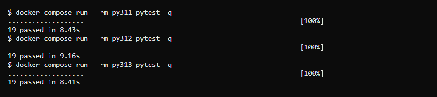
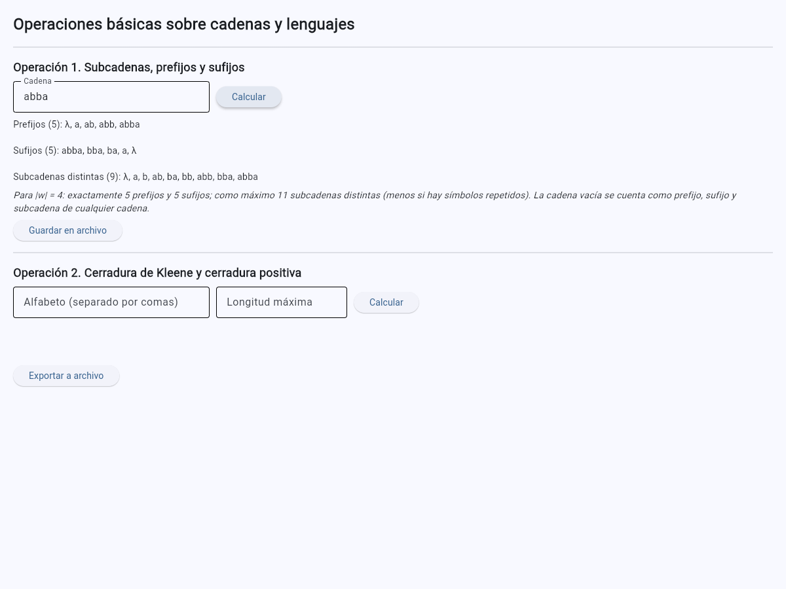
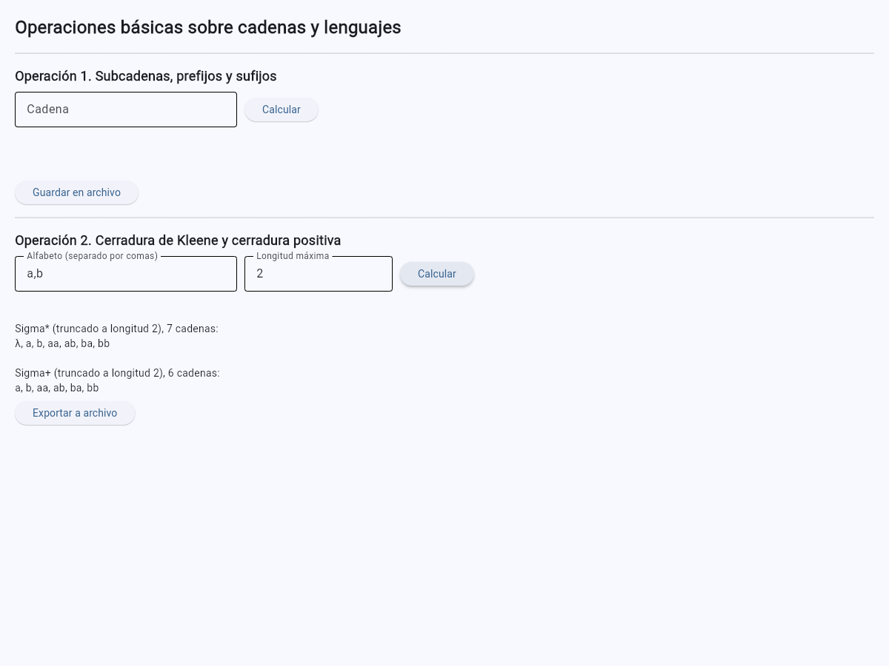
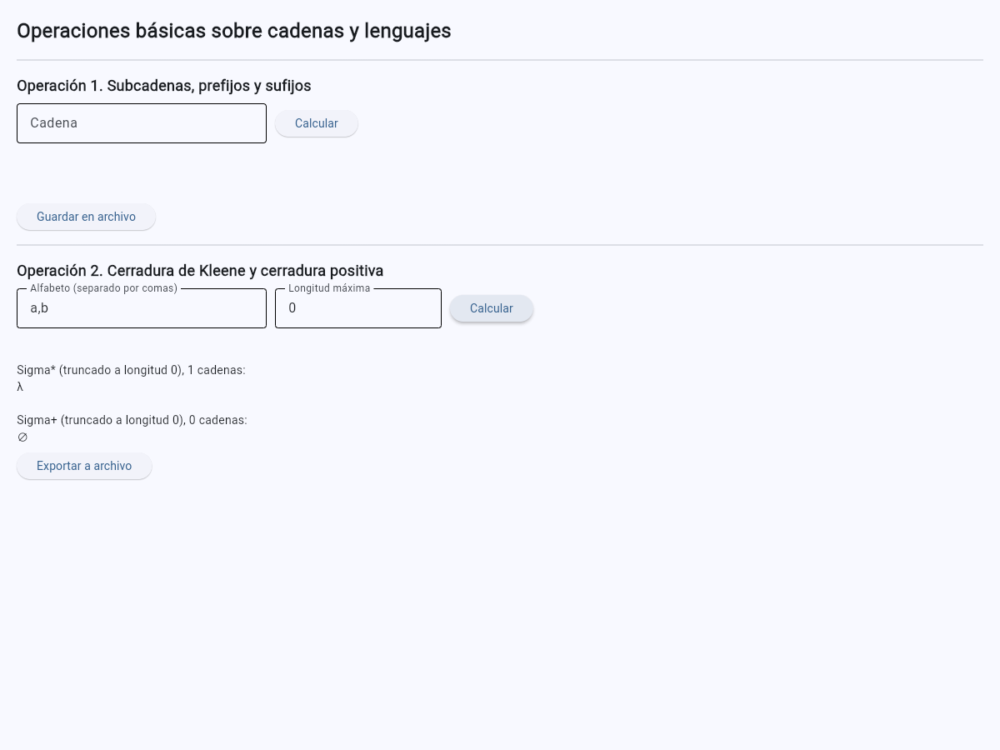
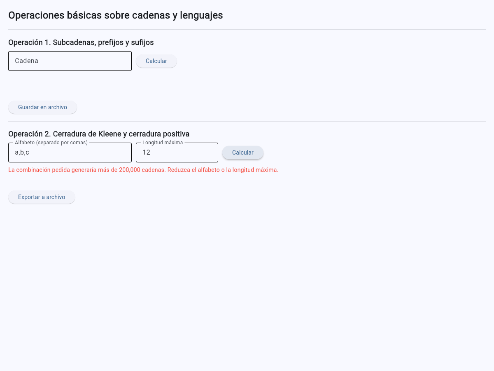

# Ejercicio 5. Aplicación con interfaz gráfica

## Estructura

Siguiendo lo que pide el enunciado, el núcleo y la interfaz están en archivos distintos:

- `src/lenguajes.py`: funciones puras (subcadenas, prefijos, sufijos, cerradura de Kleene, cerradura positiva), sin ninguna dependencia de Flet. Es lo que permite probar el programa con `pytest` sin necesitar un navegador.
- `src/app.py`: la interfaz de Flet, que solo conecta los campos de texto y botones con las funciones de `lenguajes.py`. No contiene ninguna lógica de cálculo propia.

## Operación 1. Subcadenas, prefijos y sufijos

Para una cadena w de longitud n:

- **Número de prefijos:** exactamente n + 1 (uno por cada longitud posible, de 0 a n).
- **Número de sufijos:** exactamente n + 1, por el mismo razonamiento, en el otro extremo de la cadena.
- **Número máximo de subcadenas distintas:** n(n+1)/2 + 1 — la subcadena vacía, más una subcadena por cada posible par (posición de inicio, longitud) con longitud entre 1 y n − inicio. Este máximo solo se alcanza cuando ninguna subcadena se repite en dos posiciones distintas; en la práctica, con simbolos repetidos, el número real de subcadenas distintas suele ser menor (ver la función `maximo_numero_subcadenas` en `lenguajes.py` y la prueba `test_subcadenas_alfabeto_un_simbolo`, donde la cadena `"aaa"` tiene solo 4 subcadenas distintas contra un máximo teórico de 7).
- **¿La cadena vacía figura entre los prefijos y los sufijos?** Sí, en las tres operaciones (prefijos, sufijos y subcadenas). La convención que adoptó este programa es la estándar en teoría de la computación: por definición, el único prefijo, sufijo o subcadena de longitud 0 de cualquier cadena es la cadena vacía, y toda cadena —incluida la propia cadena vacía— tiene exactamente uno. Se documentó explícitamente esta convención en el docstring del módulo `lenguajes.py`, precisamente porque el enunciado pide justificarla por escrito.

## Operación 2. Cerradura de Kleene y cerradura positiva

- El programa pide al usuario el alfabeto (separado por comas) y la longitud máxima de las cadenas a generar, porque Σ\* y Σ⁺ son, en sentido estricto, infinitos: lo que el programa puede mostrar es siempre un *truncamiento* de esa cerradura hasta la longitud que el usuario indique.
- **Relación entre el límite de 200 000 cadenas y los conceptos de la unidad.** El número de cadenas de longitud exactamente k sobre un alfabeto de tamaño |Σ| es |Σ|^k, así que el número total de cadenas hasta la longitud n crece como una suma geométrica de esas potencias: para un alfabeto de solo 3 símbolos, ya con longitud máxima 11 se superan las 200 000 cadenas (3¹¹ = 177 147, y sumando las longitudes anteriores se pasa el límite); con un alfabeto de 10 símbolos, basta una longitud máxima de 5 (10⁵ = 100 000, y la suma de 0 a 5 ya suma 111 111). Este crecimiento exponencial es exactamente la razón por la que Σ\* se define como un conjunto infinito en la teoría (Ejercicio 2, sección 5): no hay ninguna longitud máxima natural que lo agote, y cualquier programa real que quiera mostrarlo por completo tiene que truncarlo y, aun truncado, el conjunto crece demasiado rápido para poder mostrarse completo más allá de longitudes pequeñas. El programa calcula el total exacto de cadenas *antes* de generar ninguna (función `_cuenta_cerradura` en `lenguajes.py`) y rechaza la operación con un mensaje claro si supera las 200 000, en vez de intentar construir la lista y quedarse sin memoria. Las pruebas mostraron que ese límite no basta por sí solo: con un alfabeto de un símbolo y longitud máxima 199 999 hay 200 000 cadenas, pero suman unos 20 GB de símbolos, y el contenedor se quedaba sin memoria. Por eso `LIMITE_SIMBOLOS` rechaza también lo que ocuparía más de 20 millones de símbolos. El costo real depende de la longitud de las cadenas, no solo de cuántas son.
- La diferencia entre Σ\* y Σ⁺ para longitud máxima 0 es el caso de prueba más directo de esa distinción: Σ\* truncado a longitud 0 es `{""}` (un elemento, la cadena vacía), y Σ⁺ truncado a longitud 0 es el conjunto vacío `{}` (cero elementos), porque Σ⁺ nunca incluye la cadena vacía sin importar el truncamiento (ver pruebas `test_sigma_estrella_longitud_0_es_solo_lambda` y `test_sigma_positiva_longitud_0_es_vacio`).

## Pruebas automatizadas

`tests/test_lenguajes.py` cubre lo que pide el enunciado (cadena vacía, alfabeto de un símbolo, prefijos y sufijos de una cadena de longitud 1, y Σ\* frente a Σ⁺ con longitud 0), además de los límites. `tests/test_automatas.py` comprueba los `.jff` del Ejercicio 4. En total son 19 pruebas.

## Ejecución en los tres entornos

```bash
cd entorno
docker compose run --rm py311 pytest -q
docker compose run --rm py312 pytest -q
docker compose run --rm py313 pytest -q
```

| Entorno | Intérprete | Resultado de `pytest -q` | Salida | Diferencia observada |
|---|---|---|---|---|
| `py311` | Python 3.11.18 | 19 passed | [texto](../evidencias/app/pytest-py311.txt) | Ninguna |
| `py312` | Python 3.12.16 | 19 passed | [texto](../evidencias/app/pytest-py312.txt) | Ninguna |
| `py313` | Python 3.13.18 | 19 passed | [texto](../evidencias/app/pytest-py313.txt) | Ninguna |



No hubo diferencias entre versiones: el núcleo solo usa funciones estándar que existen en las tres.

La interfaz se abre desde el navegador del equipo al levantar el servicio `py312`:

```bash
docker compose up py312
# abrir http://localhost:8550
```

## La interfaz servida desde el contenedor

Las capturas se tomaron de http://localhost:8550 con el servicio `py312` en ejecución.

**Operación 1 con `abba`:**



El botón *Guardar en archivo* descarga el resultado en el navegador: [`operacion1_resultado.txt`](../evidencias/app/operacion1_resultado.txt). Se cambió a la API actual de Flet, que en modo web exige `save_file(src_bytes=...)`; la anterior, `on_result`, ya no existe en la versión 0.86.5.

**Operación 2 con Σ = {a, b} y longitud 2:**



**Longitud 0:** Σ\* = {λ} y Σ⁺ = ∅.



**Rechazo por límite con Σ = {a, b, c} y longitud 12:**


